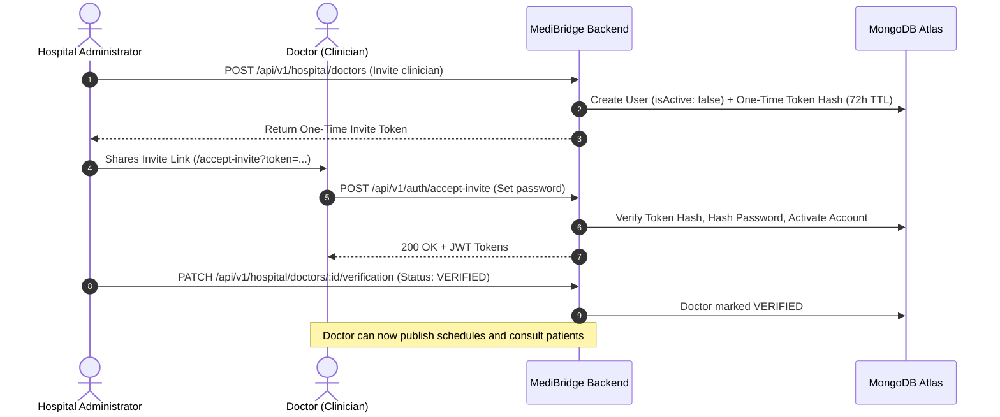
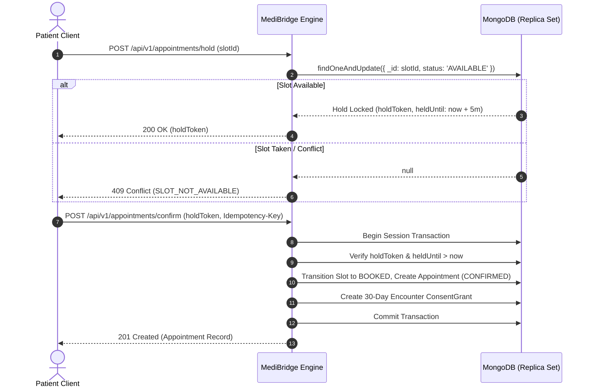

# MediBridge — System Architecture Specification
## SRIJAN 2026 DevFusion — "Where Web Meets Mobile Innovation"

---

## 1. Executive Architecture Summary

**MediBridge** is a secure, modular healthcare coordination and consultation platform engineered to bridge patients, verified clinicians, and healthcare fiduciaries into a cohesive digital health ecosystem. 

Designed under the regulatory framework of India's **Digital Personal Data Protection Act, 2023 (DPDPA)**, the **Ayushman Bharat Digital Mission (ABDM)** Health Data Management Policy, and the **National Medical Commission (NMC) Telemedicine Practice Guidelines**, MediBridge eliminates fragmented health communication through verifiable doctor onboarding, consent-driven record access, and high-concurrency appointment scheduling.

```mermaid
flowchart TD
    Client["Client Web SPA (React 19 + TypeScript + Vite)"]
    
    subgraph EdgeGateways ["Edge & Security Middleware"]
        CORS["CORS & Security Headers (CSP, FrameOptions)"]
        RateLimit["Sliding Window Rate Limiters"]
        AuthMid["JWT Auth & Invalidation Checks"]
        RBACMid["Role Scope & Actor Verification (ABAC)"]
    end
    
    subgraph BackendCore ["Express REST Core (Node.js + TS)"]
        AuthMod["Auth & Onboarding Module"]
        HospMod["Hospital Administration Module"]
        DocMod["Doctor Verification & Availability"]
        ApptMod["Two-Phase Booking Engine & Idempotency"]
        MedMod["Encrypted PHI Records (AES-256-GCM)"]
        RxMod["Prescription Digital Signature Flow"]
        ConsentMod["Consent Management & Break-Glass"]
        AuditMod["Tamper-Evident Audit Logging"]
        AIMod["Multi-Provider AI Subsystem (Gemini/Mock)"]
    end
    
    subgraph StorageEngine ["Persistence & File Vault"]
        MongoAtlas[("MongoDB Atlas / Replica Set")]
        SecureFiles[("Private Storage: Authenticated Streaming Proxy")]
    end
    
    Client -->|HTTP/REST with Bearer JWT| EdgeGateways
    EdgeGateways --> BackendCore
    BackendCore -->|Mongoose ODM / Multi-Doc Transactions| MongoAtlas
    BackendCore -->|Authenticated Streams (Magic Bytes)| SecureFiles
```

---

## 2. Technology Stack & Workspace Division

MediBridge enforces strict workspace manifest independence between frontend and backend.

| Layer | Technologies & Libraries | Purpose & Standard |
| :--- | :--- | :--- |
| **Frontend SPA** | React 19, TypeScript 5.7, Vite 6, React Router 7, Lucide Icons | Responsive client for desktop, tablet, and mobile with zero third-party UI framework bloat. |
| **Backend REST API** | Node.js 22, Express 4.21, TypeScript 5.7, Zod 3.24, Pino 9 | Modular REST service delivering strict JSON responses with typed error contracts. |
| **Database Engine** | MongoDB 6.0/7.0 & MongoDB Atlas | Document database utilizing replica set multi-document transactions and compound unique indexes. |
| **Cryptography** | Node.js native `crypto` module | AES-256-GCM envelope encryption, bcrypt password hashing (12 rounds), HMAC-SHA256 action tokens. |
| **AI Integration** | Google GenAI SDK (`@google/genai`), Multi-provider adapter | Live conversational triage (`gemini-3.8-flash`) and deterministic test adapter (`mock`). |

---

## 3. Core Subsystem Architecture

### 3.1 Role & Identity Governance

MediBridge segregates actors into four discrete operational roles with server-enforced boundaries:

1. **`PATIENT`**:
   - Only role eligible for open public registration (`POST /api/v1/auth/register`).
   - Access restricted to own appointments, health records, prescriptions, and consent controls.
2. **`DOCTOR`**:
   - Cannot self-register publicly. Invited exclusively by a verified hospital administrator (`POST /api/v1/hospital/doctors`).
   - Must be verified (`verificationStatus: 'VERIFIED'`) by the hospital admin before publishing availability or appearing in patient directories.
   - Access bounded by active consultation encounter or explicit patient consent grant.
3. **`HOSPITAL`**:
   - Hospital administrator created via idempotent platform bootstrap CLI (`npm run bootstrap:hospital-admin`).
   - Manages hospital facility profiles, clinical departments, doctor roster, registration verification, and appointment overviews.
4. **`ADMIN`**:
   - Platform compliance administrator.
   - Enforces audit compliance telemetry, system-wide metrics, and tamper-evident audit log review. Admin accounts never view clinical PHI without explicit justification.



---

### 3.2 High-Concurrency Appointment Scheduling Engine

To prevent race conditions, slot overbooking, and ghost appointments, MediBridge implements a **Two-Phase Slot Hold & Atomic Confirmation** architecture:

1. **Database Constraint**:
   - A compound unique index on `{ doctorId: 1, startTime: 1 }` (`activeSlotKey`) across `PENDING`, `CONFIRMED`, and `SCHEDULED` appointments guarantees at the database storage engine level that duplicate bookings are impossible.
2. **Two-Phase Commit Protocol**:
   - **Phase 1 (Atomic Hold)**: Patient selects a slot. Backend executes atomic `findOneAndUpdate` with condition (`status: 'AVAILABLE'` OR expired hold `heldUntil < now`), placing a 5-minute checkout lock with a cryptographically secure `holdToken`.
   - **Phase 2 (Atomic Confirmation)**: Executed inside a MongoDB multi-document transaction with mandatory `Idempotency-Key` header validation. Validates hold token ownership and 5-minute timeout before transitioning slot to `BOOKED` and generating appointment and encounter consent grant records.



---

### 3.3 Hybrid Consent & Cryptographic Data Protection

Sensitive clinical notes, psychiatric evaluations, and diagnostic summaries are protected through defense-in-depth:

- **Field-Level Encryption at Rest (AES-256-GCM)**:
  - Cryptographic standard: AES-256-GCM with unique 96-bit (12-byte) initialization vectors (`crypto.randomBytes(12)`) per record. IV reuse is cryptographically prevented.
  - Envelope Format: `enc:v1:<iv_hex>:<auth_tag_hex>:<ciphertext_hex>`.
  - Integrity: The 128-bit authentication tag guarantees that tampered ciphertexts are rejected before decryption.
- **Hybrid Consent Evaluation**:
  - Access is evaluated on every request server-side:
    $$\text{Access} = (\text{EncounterActive} \lor \text{ActiveConsentGrant}) \land \neg\text{IsRevoked} \land \neg\text{IsExpired}$$
  - Revocation is instantaneous: revoking a consent category or grant immediately halts access across active sessions.
- **Authenticated Medical File Streaming Proxy**:
  - Medical files, DICOM scans, and lab PDFs reside in private storage (`uploads/secure_records`) with zero public web serving.
  - Streaming endpoint (`GET /api/v1/medical-records/:id/files/:fileId`) enforces authentication, consent checking, and magic-byte inspection before directly piping file chunks to authorized clients.

---

### 3.4 Multi-Provider AI Architecture & Safety Guardrails

MediBridge incorporates artificial intelligence designed for clinical safety and triage without unauthorized mutations:

- **Provider Abstraction (`IAIProviderAdapter`)**:
  - Standardized interface supporting Google Gemini (`gemini-3.8-flash`), OpenAI (`gpt-4o-mini`), Anthropic (`claude-3-5-sonnet`), and deterministic offline `MockAIAdapter`.
- **Triage Chatbot Boundary**:
  - Informational and triage assistant with **ZERO database mutation rights**.
  - Mandatory disclaimer attached to every response:
    > *"MediBridge AI Assistant provides informational guidance only and is not a substitute for professional medical judgment, diagnosis, or treatment. In medical emergencies, immediately contact local emergency services (112)."*
- **Consequential AI Agent Actions**:
  - Actions modifying appointments or records cannot be committed autonomously by the AI.
  - Generates a staged proposal requiring explicit user verification using a single-use HMAC-SHA256 signed action token:
    $$\text{Token} = \text{HMAC-SHA256}(\text{userId} + \text{action} + \text{resourceId} + \text{nonce} + \text{expiresAt}, K_{\text{auth}})$$
  - Tokens expire in 5 minutes and enforce single-use execution via nonce tracking to prevent replay attacks.

---

## 4. API Standardization & Error Contract

All API communications strictly implement predictable envelopes:

### Success Response (`200 OK`, `201 Created`)
```json
{
  "success": true,
  "data": {
    "id": "6722...",
    "status": "CONFIRMED"
  }
}
```

### Error Response (`400`, `401`, `403`, `404`, `409`, `429`, `500`)
```json
{
  "success": false,
  "error": {
    "code": "SLOT_ALREADY_BOOKED",
    "message": "The selected consultation time is no longer available.",
    "details": null,
    "requestId": "req-98f2a1b7-c918"
  }
}
```

---

## 5. Mobile & Responsive Layout Design

The user interface follows mobile-first responsive architecture:
- Fluid layouts scaling across viewport breakpoints: mobile (`<640px`), tablet (`640px - 1024px`), and desktop (`>1024px`).
- Collapsible navigation drawers with complete focus traps, keyboard accessibility (`Esc` to close), and ARIA landmark roles.
- Minimum touch targets ($\ge 44 \times 44\text{px}$) on all buttons and form controls.
- WCAG AA compliant contrast ratios ($\ge 4.5:1$) across all typography and states.
