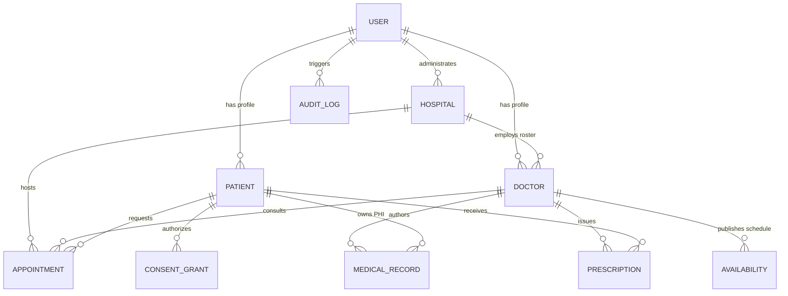

# MediBridge — Database Schema & Data Models Specification
## MongoDB & MongoDB Atlas Architectural Mapping

---

## 1. Overview & Storage Engine Lifecycle

MediBridge is backed by **MongoDB Atlas** (and local MongoDB 6.0/7.0 single-node replica sets in development). The database architecture leverages document-level atomicity, compound unique constraints, and multi-document transactions to enforce healthcare compliance and booking concurrency.



---

## 2. Document Collections & Schema Details

### 2.1 Collection: `users`
Maintains core authentication identity, role scopes, and invitation state.

| Field | Type | Validation / Index | Description |
| :--- | :--- | :--- | :--- |
| `_id` | ObjectId | Primary Key | Unique user identifier |
| `name` | String | Trimmed, 2–120 chars | User display name |
| `email` | String | Lowercase, Unique Index | Unique login email |
| `passwordHash` | String | Bcrypt (12 rounds) | Securely hashed password |
| `role` | String | Enum: `PATIENT`, `DOCTOR`, `HOSPITAL`, `ADMIN` | Role-based authorization scope |
| `hospitalId` | ObjectId | Ref: `hospitals`, Sparse Index | Linked facility for hospital admins and doctors |
| `isActive` | Boolean | Default: `true` | Account activation flag |
| `isTestAccount` | Boolean | Default: `false` | Explicit indicator for test data |
| `inviteTokenHash` | String | Select: `false` | SHA-256 hash of one-time doctor invite token |
| `inviteExpiresAt` | Date | Select: `false` | Expiration timestamp for invite token (72h TTL) |
| `timestamps` | Date | Automatic | `createdAt`, `updatedAt` |

---

### 2.2 Collection: `hospitals`
Represents registered clinical facilities and their clinical departments.

| Field | Type | Description |
| :--- | :--- | :--- |
| `_id` | ObjectId | Hospital document ID |
| `name` | String | Legal facility name |
| `address` | String | Physical hospital address |
| `phone` | String | E.164 phone contact |
| `email` | String | Official administrative email |
| `departments` | Array | `[{ _id, name: String, isActive: Boolean }]` |
| `isVerified` | Boolean | Clinical accreditation and verification status |

---

### 2.3 Collection: `doctors`
Professional clinician profiles containing licensing and specialization metadata.

| Field | Type | Validation / Index | Description |
| :--- | :--- | :--- | :--- |
| `_id` | ObjectId | Primary Key | Doctor profile ID |
| `userId` | ObjectId | Ref: `users`, Unique | Linked user account |
| `fullName` | String | Trimmed, min 2 chars | Clinician full name |
| `hospitalId` | ObjectId | Ref: `hospitals`, Index | Affiliated healthcare facility |
| `departmentId` | ObjectId | Index | Clinical department reference |
| `licenseNumber` | String | Unique Index | NMC / State Medical Council registration |
| `specialization`| String | Trimmed | Medical specialty (e.g. Cardiology) |
| `qualifications`| Array of Strings | E.g. `["MBBS", "MD"]` | Certified medical degrees |
| `consultationFee`| Number | Non-negative | Standard consultation fee (INR) |
| `verificationStatus` | String | Enum: `PENDING`, `VERIFIED`, `REJECTED` | Hospital verification status |
| `location` | GeoJSON Point | 2dsphere index | `[longitude, latitude]` for geolocation matching |

---

### 2.4 Collection: `patients`
Demographic profile for registered patients.

| Field | Type | Description |
| :--- | :--- | :--- |
| `_id` | ObjectId | Patient profile ID |
| `userId` | ObjectId | Ref: `users`, Unique | Linked user account |
| `fullName` | String | Full legal name |
| `dateOfBirth` | String | Format: `YYYY-MM-DD` |
| `gender` | String | Enum: `FEMALE`, `MALE`, `OTHER` |
| `phone` | String | Contact phone number |
| `specialId` | String | Unique pseudonym code (e.g. `#MB-PAT-4912`) |

---

### 2.5 Collection: `appointments`
Enforces the lifecycle of consultation requests and scheduled visits.

| Field | Type | Validation / Index | Description |
| :--- | :--- | :--- | :--- |
| `_id` | ObjectId | Primary Key | Appointment ID |
| `hospitalId` | ObjectId | Ref: `hospitals`, Index | Hospital where visit occurs |
| `doctorId` | ObjectId | Ref: `doctors`, Index | Assigned physician |
| `patientId` | ObjectId | Ref: `patients`, Index | Patient requesting care |
| `startTime` | Date | UTC Timestamp | Consultation start time |
| `endTime` | Date | UTC Timestamp | Consultation end time |
| `mode` | String | Enum: `IN_PERSON`, `VIDEO` | Consultation modality |
| `status` | String | Enum: `PENDING`, `CONFIRMED`, `COMPLETED`, `CANCELLED`, `NO_SHOW` | Current consultation status |
| `reason` | String | Max 200 chars | Clinical visit reason |
| `activeSlotKey` | String | **Compound Unique Sparse Index** | Format: `doctorId\|startTime` (Guards active bookings) |
| `slotId` | ObjectId | Ref: `slots`, Unique Sparse | Associated slot from legacy calendar |
| `holdToken` | String | Secure Token | 5-minute checkout hold reservation |
| `heldUntil` | Date | Expiration Index | Lock expiry timestamp |

---

### 2.6 Collection: `availabilities`
Doctor schedule templates establishing recurring weekly windows and planned leave.

- **`type: 'WEEKLY'`**: `{ doctorId, dayOfWeek: 0..6, startTime: "09:00", endTime: "13:00", slotMinutes: 30 }`
- **`type: 'LEAVE'`**: `{ doctorId, date: "YYYY-MM-DD", reason: String }` (Unique compound index on `{ doctorId: 1, date: 1 }`).

---

### 2.7 Collection: `medicalrecords`
Clinical health records containing Protected Health Information (PHI) encrypted at rest.

| Field | Type | Description |
| :--- | :--- | :--- |
| `_id` | ObjectId | Record identifier |
| `patientId` | ObjectId | Subject patient ID |
| `doctorId` | ObjectId | Authoring clinician ID |
| `encounterId` | ObjectId | Linked appointment ID |
| `category` | String | Enum: `CLINICAL_NOTES`, `LAB_RESULTS`, `PRESCRIPTIONS`, `IMAGING_REPORTS` |
| `encryptedNotes` | String | **AES-256-GCM Envelope**: `enc:v1:<iv>:<tag>:<ciphertext>` |
| `files` | Array | `[{ fileId, fileName, mimeType, checksum, sizeBytes }]` |

---

### 2.8 Collection: `prescriptions`
Clinician-issued electronic prescriptions governed by digital signatures.

| Field | Type | Description |
| :--- | :--- | :--- |
| `_id` | ObjectId | Prescription ID |
| `doctorId` | ObjectId | Issuing RMP |
| `patientId` | ObjectId | Recipient patient |
| `medications` | Array | `[{ name, dosage, frequency, duration, instructions }]` |
| `status` | String | Enum: `DRAFT_PENDING_DOCTOR_SIGNATURE`, `ISSUED`, `CANCELLED` |
| `digitalSignature` | String | HMAC-SHA256 Doctor Signature: `sig:v1:<hash>` |
| `signedAt` | Date | Timestamp of digital signature |

---

### 2.9 Collection: `consentgrants`
Fine-grained patient consent artifacts governing healthcare data access.

| Field | Type | Description |
| :--- | :--- | :--- |
| `_id` | ObjectId | Consent grant ID |
| `patientId` | ObjectId | Grantor patient |
| `doctorId` | ObjectId | Grantee clinician |
| `encounterId` | ObjectId | Optional consultation scope |
| `categories` | Array of Strings | Permitted record categories |
| `status` | String | Enum: `ACTIVE`, `REVOKED`, `EXPIRED` |
| `grantedAt` | Date | Timestamp of patient approval |
| `expiresAt` | Date | Automated expiry timestamp (e.g. 30 days) |
| `revokedAt` | Date | Instant revocation timestamp |

---

### 2.10 Collection: `auditlogs`
Immutable append-only audit trail capturing Protected Health Information (PHI) interactions.

```json
{
  "_id": "6722c...",
  "actorId": "6722a1...",
  "actorRole": "DOCTOR",
  "action": "PHI_READ",
  "resourceType": "MedicalRecord",
  "resourceId": "6722d4...",
  "patientId": "6722b2...",
  "timestamp": "2026-10-30T10:15:30.000Z",
  "ipAddress": "127.0.0.1",
  "outcome": "SUCCESS",
  "details": { "category": "CLINICAL_NOTES" }
}
```

---

## 3. Database Constraints & Indexing Strategy

1. **Active Booking Guard**:
   - `appointments.createIndex({ activeSlotKey: 1 }, { unique: true, sparse: true })`
   - Guarantees zero double-booking even under concurrent race conditions.
2. **Clinician Accreditation**:
   - `doctors.createIndex({ hospitalId: 1, departmentId: 1, verificationStatus: 1 })`
   - Accelerates catalog discovery of verified specialists.
3. **Emergency Audit & Search**:
   - `auditlogs.createIndex({ patientId: 1, timestamp: -1 })`
   - `auditlogs.createIndex({ actorId: 1, action: 1, timestamp: -1 })`
4. **Geo-Location Matcher**:
   - `doctors.createIndex({ location: "2dsphere" })`
   - Powers spatial queries for finding nearest available healthcare providers.
