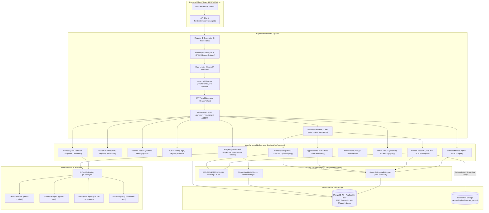
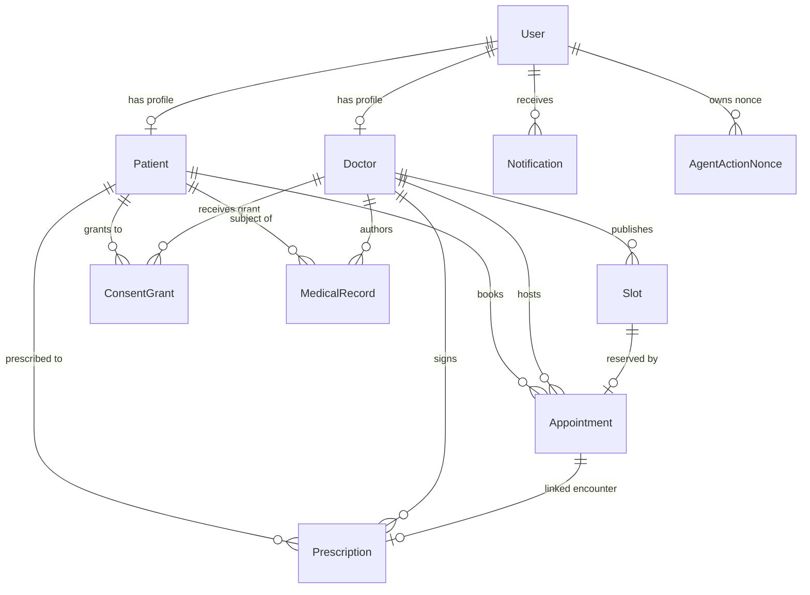

# MediBridge: Architecture, Implementation & Repository Analysis

> **Analysis Date**: October 2026  
> **Platform Version**: 0.1.0  
> **Repository Root**: `.` (Current Working Directory)  
> **Authoritative Specification**: [`AGENTS.md`](./AGENTS.md) & Source Code Verification  
> **Verification Status**: 191 Tests Passing (180 Backend, 11 Frontend) • Typecheck Clean • ESLint Clean • Production Build Clean  

---

## Table of Contents

1. [Executive Summary](#1-executive-summary)
2. [Project Overview](#2-project-overview)
3. [Technology Stack & Dependency Audit](#3-technology-stack--dependency-audit)
4. [System Architecture & Flow Analysis](#4-system-architecture--flow-analysis)
5. [User Roles & Portal Capabilities](#5-user-roles--portal-capabilities)
6. [Services & Functional Modules](#6-services--functional-modules)
7. [Comprehensive API Documentation](#7-comprehensive-api-documentation)
8. [Database Architecture & Data Models](#8-database-architecture--data-models)
9. [Security, Cryptography & Compliance Analysis](#9-security-cryptography--compliance-analysis)
10. [Repository Structure & Codebase Map](#10-repository-structure--codebase-map)
11. [Testing, CI/CD & Deployment Operations](#11-testing-cicd--deployment-operations)
12. [Implementation Gaps, Discrepancies & Limitations](#12-implementation-gaps-discrepancies--limitations)
13. [Developer Quick Start Guide](#13-developer-quick-start-guide)

---

## 1. Executive Summary

MediBridge is an enterprise-grade modular monolith healthcare consultation and consent-driven health data exchange platform engineered under the legal frameworks of India's Digital Personal Data Protection Act (DPDPA 2023) and National Medical Commission (NMC) Telemedicine Practice Guidelines. The platform pairs a React 19 / TypeScript single-page application with a Node.js / Express REST API and a MongoDB 7.0+ document database. 

Core technical achievements include: (1) an Attribute-Based Access Control (ABAC) consent engine providing instantaneous revocation and authenticated streaming proxy delivery of medical files; (2) AES-256-GCM field-level encryption for Protected Health Information (PHI) at rest; (3) a two-phase slot reservation mechanism combining atomic conditional holds with MongoDB multi-document ACID transactions and unique compound indexing to prevent double-booking race conditions; (4) a tamper-evident digital prescription issuance workflow backed by HMAC-SHA256 signature digests and a versioned verification keyring; (5) an append-only audit trail capturing all PHI read/mutation events; and (6) a dual AI architecture separating an informational triage chatbot with zero database mutation rights from a sandboxed AI agent executing consequential clinical actions strictly through user-confirmed, single-use, 5-minute HMAC confirmation tokens.

The codebase compiles with strict TypeScript typing (`strict: true`), passes comprehensive ESLint rules with zero warnings, and is validated by 191 automated unit, integration, concurrency, and security tests.

---

## 2. Project Overview

### 2.1 Problem Space
Digital healthcare platforms face acute regulatory, technical, and trust challenges:
- **Uncontrolled PHI Exposure**: Medical records and lab reports are frequently stored in public cloud buckets or served via static web roots without real-time authorization checks.
- **Coarse Consent Mechanisms**: Patients are traditionally asked for binary, irrevocable consent rather than time-bounded, category-scoped data sharing.
- **Teleconsultation Credential Fraud**: Unverified practitioners presenting illegitimate credentials pose critical liability and clinical safety risks.
- **Booking Race Conditions**: Concurrent appointment requests frequently result in double-booking errors during high-demand clinician scheduling windows.
- **AI Hallucinations in Clinical Settings**: Autonomous LLMs deployed without strict boundaries may fabricate medical advice, prescribe unauthorized medications, or execute unconfirmed mutations.

### 2.2 MediBridge Solution
MediBridge resolves these challenges through defense-in-depth architectural constraints:
- **Consent-Governed File Streaming Proxy**: Medical files are never publicly exposed; they are streamed through an authenticated endpoint (`GET /api/v1/medical-records/:id/files/:fileId`) that verifies active patient consent in real time. Revoking consent immediately halts subsequent stream requests with `403 Forbidden`.
- **Hybrid Consent Model**: Combines category permissions (`CLINICAL_NOTES`, `LAB_RESULTS`, `PRESCRIPTIONS`, `IMAGING_REPORTS`) with encounter-scoped grants (e.g., automatically created 30-day access following confirmed appointments).
- **RMP Verification Gate**: Doctors registering on the platform enter a `PENDING` state and cannot author medical records, publish slots, or sign prescriptions until verified by a Platform Administrator against NMC registry databases.
- **Two-Phase Slot Checkout & ACID Confirmation**: Prevents double-booking via conditional atomic holds (`$set: { status: 'HELD' }` with 5-minute locks) followed by MongoDB multi-document transactional booking confirmations.
- **Air-Gapped AI Safety Boundaries**: Informational chatbot assistance has zero database mutation permissions. The autonomous AI agent cannot execute consequential actions directly; it stages uncommitted actions returning a single-use HMAC-SHA256 confirmation token requiring explicit human confirmation within 5 minutes.

### 2.3 Intended Users
1. **Patients**: Discover verified clinicians, reserve consultation slots via two-phase checkout locks, manage granular data-sharing consent grants, view encrypted records, and access digitally signed prescriptions.
2. **Registered Medical Practitioners (RMPs / Doctors)**: Manage clinical consultation queues, review patient histories under active consent, draft and cryptographically sign digital prescriptions, and publish appointment availability.
3. **Platform Administrators**: Supervise practitioner credential verification, inspect tamper-evident audit logs, monitor platform telemetry, and enforce statutory DPDPA compliance.
4. **Institutional Healthcare Facilities**: Coordinate cross-departmental clinician rosters and clinical capacity (currently implemented via frontend coordination views).

---

## 3. Technology Stack & Dependency Audit

The repository maintains strict workspace isolation between the frontend and backend. The root `package.json` provides developer convenience scripts via `concurrently` and does not hoist dependencies.

```
MediBridge Technology Stack
├── Frontend (Client SPA)
│   ├── React (v19.0.0) & React DOM (v19.0.0)
│   ├── Vite (v6.0.3)
│   ├── TypeScript (v5.7.2)
│   ├── Vitest (v2.1.8) & React Testing Library (v16.1.0)
│   ├── jsdom (v25.0.1)
│   └── Editorial Design System (Custom CSS Custom Properties / theme.css)
├── Backend (Modular REST API)
│   ├── Node.js (>=24.0.0 Target)
│   ├── Express (v4.21.2)
│   ├── TypeScript (v5.7.2) & tsx (v4.19.2)
│   ├── Mongoose (v8.9.0) & MongoDB 7.0+
│   ├── Zod (v3.24.1)
│   ├── bcryptjs (v2.4.3) & jsonwebtoken (v9.0.2)
│   ├── Pino (v9.5.0) & pino-http (v10.3.0)
│   ├── Vitest (v2.1.8), Supertest (v7.0.0), mongodb-memory-server (v10.1.2)
│   └── Native Node.js crypto (AES-256-GCM, HMAC-SHA256, timingSafeEqual)
└── Infrastructure & Tooling
    ├── Docker & Docker Compose (mongo:7.0 replica set, Node 24 Alpine, Nginx Alpine)
    ├── ESLint (v9.16.0) & typescript-eslint (v8.17.0)
    └── GitHub Actions CI (.github/workflows/ci.yml)
```

### 3.1 Detailed Workspace Dependencies

| Category | Package / Tool | Version | Role in MediBridge | Source Evidence |
| :--- | :--- | :--- | :--- | :--- |
| **Frontend Framework** | `react` | `^19.0.0` | UI component tree rendering | [`frontend/package.json`](./frontend/package.json) |
| **Frontend DOM** | `react-dom` | `^19.0.0` | Browser DOM reconciliation | [`frontend/package.json`](./frontend/package.json) |
| **Frontend Build Tool** | `vite` | `^6.0.3` | Client bundling, HMR, production build | [`frontend/package.json`](./frontend/package.json) |
| **Frontend Styling** | Custom CSS | Native CSS3 | Warm Ivory / Midnight Navy design tokens (`theme.css`) | [`frontend/src/styles/theme.css`](./frontend/src/styles/theme.css) |
| **Frontend Testing** | `vitest` | `^2.1.8` | Client test runner | [`frontend/package.json`](./frontend/package.json) |
| **Frontend DOM Testing**| `@testing-library/react` | `^16.1.0` | React component integration tests | [`frontend/package.json`](./frontend/package.json) |
| **Backend Framework** | `express` | `^4.21.2` | HTTP REST API routing and middleware pipeline | [`backend/package.json`](./backend/package.json) |
| **Database ODM** | `mongoose` | `^8.9.0` | MongoDB object modeling, transactions, indexes | [`backend/package.json`](./backend/package.json) |
| **Schema Validation** | `zod` | `^3.24.1` | Environment variable parsing and validation | [`backend/package.json`](./backend/package.json) |
| **Password Hashing** | `bcryptjs` | `^2.4.3` | Salted password hashing (12 rounds) | [`backend/package.json`](./backend/package.json) |
| **Session Security** | `jsonwebtoken` | `^9.0.2` | Signed JWT access (15m) and refresh (7d) tokens | [`backend/package.json`](./backend/package.json) |
| **Application Logging** | `pino`, `pino-http` | `^9.5.0` | High-performance logger with automatic PHI redaction | [`backend/package.json`](./backend/package.json) |
| **Backend Testing** | `vitest` | `^2.1.8` | Server test runner | [`backend/package.json`](./backend/package.json) |
| **Embedded Database** | `mongodb-memory-server`| `^10.1.2` | In-memory MongoDB instance for isolated testing | [`backend/package.json`](./backend/package.json) |
| **HTTP Testing** | `supertest` | `^7.0.0` | End-to-end HTTP endpoint assertion | [`backend/package.json`](./backend/package.json) |
| **Container Engine** | Docker Compose | Compose v2 | Multi-container orchestration (Mongo, API, Nginx) | [`docker-compose.yml`](./docker-compose.yml) |

> [!NOTE]
> **Tech Stack Discrepancy Findings**:
> 1. **Password Hashing**: `README.md` claims "Argon2id password hashing", but the code strictly implements `bcryptjs` (salt rounds: 12) in [`backend/src/lib/crypto.ts`](./backend/src/lib/crypto.ts#L54-L61).
> 2. **CSS Framework**: `README.md` lists "Tailwind CSS", but neither `tailwindcss`, `@tailwindcss/vite`, nor `postcss` is installed in `frontend/package.json`. Styling is implemented via CSS variables in [`frontend/src/styles/theme.css`](./frontend/src/styles/theme.css).
> 3. **AI SDKs**: The AI provider adapters implement direct HTTP calls via native Node.js `fetch` rather than external provider SDKs (`@google/generative-ai`, `openai`, `@anthropic-ai/sdk`), keeping dependencies minimal.

---

## 4. System Architecture & Flow Analysis

### 4.1 High-Level Architecture Diagram



### 4.2 Data & Request Flow Lifecycle

1. **Incoming Request**: Passes through `requestIdMiddleware` (assigns UUID or preserves incoming header), `securityHeadersMiddleware` (CSP, nosniff, frame denial), and rate limiters.
2. **Authentication**: `authenticate` validates the JWT access token and decorates `req.user` with `{ userId, role, email }`.
3. **Authorization (RBAC & Verification Guard)**: `requireRole` verifies membership in allowed roles (`PATIENT`, `DOCTOR`, `ADMIN`). For clinical operations, `requireVerifiedDoctor` inspects [`DoctorModel`](./backend/src/modules/doctors/doctor.model.ts) to verify `verificationStatus === 'VERIFIED'`.
4. **ABAC Evaluation**: When accessing Protected Health Information (PHI), `evaluateConsentAccess` performs real-time queries against [`ConsentGrantModel`](./backend/src/modules/consent/consent.model.ts) to confirm active, unexpired consent matching doctor ID, patient ID, record category, and encounter scope.
5. **Decryption / Streaming**: Authorized clinical notes are decrypted on-demand via `decryptPhi()`. Files are streamed via authenticated proxy [`streamRecordFileAttachment`](./backend/src/modules/medical-records/medical-record.service.ts#L159-L235).
6. **Append-Only Auditing**: Every access or denial logs an audit entry via `logAuditEvent` to [`AuditLogModel`](./backend/src/modules/audit/audit.model.ts).
7. **Response Formatting**: Standardized JSON envelopes `{ success: true, data: <payload> }` or `{ success: false, error: { code, message, details, requestId } }`.

---

## 5. User Roles & Portal Capabilities

| Role / Portal | Backend Implementation Status | Frontend Implementation Status | Accessible Features & Enforced Boundary Rules | Evidence Files |
| :--- | :--- | :--- | :--- | :--- |
| **`PATIENT`** | **Implemented & Verified** | **Implemented & Verified** | • Browse verified doctors and public slots.<br>• Reserve slots via 2-phase hold (5-min lock) and confirm booking.<br>• Cancel scheduled appointments.<br>• Manage and instantaneously revoke consent grants.<br>• Access decrypted personal medical records.<br>• View issued digital prescriptions with signature digests.<br>• Query AI triage chatbot and stage AI agent actions.<br>*Boundary*: Cannot draft records/prescriptions or access administrative telemetry. | [`patient.routes.ts`](./backend/src/modules/patients/patient.routes.ts)<br>[`PatientPortal.tsx`](./frontend/src/features/patient/PatientPortal.tsx) |
| **`DOCTOR`** | **Implemented & Verified** | **Implemented & Verified** | • Submit NMC registration credentials upon signup.<br>• Publish consultation availability slots (when verified).<br>• Access clinical queue and scheduled patient appointments.<br>• Author medical records encrypted at rest with AES-256-GCM.<br>• Access patient records under verified ABAC consent.<br>• Draft prescriptions (`DRAFT_PENDING_DOCTOR_SIGNATURE`).<br>• Digitally sign prescriptions (`ISSUED`) with HMAC signature.<br>*Boundary*: Restricted by `requireVerifiedDoctor` if `verificationStatus !== 'VERIFIED'`. | [`doctor.routes.ts`](./backend/src/modules/doctors/doctor.routes.ts)<br>[`verification.guard.ts`](./backend/src/modules/doctors/verification.guard.ts)<br>[`DoctorPortal.tsx`](./frontend/src/features/doctors/DoctorPortal.tsx) |
| **`ADMIN`** | **Implemented & Verified** | **Implemented & Verified** | • Inspect overall system telemetry (user counts, doctor stats, appointments).<br>• Review pending clinician registrations and verify or reject credentials (`/doctors/:id/verify`).<br>• Query append-only compliance audit trail (`/admin/audit-logs`).<br>*Boundary*: Strict data minimization; Administrators have **no** read access to patient clinical notes or files. | [`admin.routes.ts`](./backend/src/modules/admin/admin.routes.ts)<br>[`AdminPortal.tsx`](./frontend/src/features/admin/AdminPortal.tsx) |
| **`HOSPITAL`** | **Planned (Backend)** | **Implemented (UI Facility View)** | • Frontend view for department coordination and roster visibility.<br>*Boundary*: The backend does not implement a `HOSPITAL` role enum or database model. The frontend displays an honest `Architectural Boundary Notice` explaining this separation. | [`HospitalPortal.tsx`](./frontend/src/features/hospital/HospitalPortal.tsx#L81-L84) |
| **`PUBLIC`** | **Implemented** | **Implemented** | • Public clinician directory discovery (`/api/v1/doctors`).<br>• Editorial healthcare brand sections, FAQ, and trust guidelines.<br>• Direct role-based authentication entrypoints. | [`LandingPage.tsx`](./frontend/src/features/public/LandingPage.tsx) |

---

## 6. Services & Functional Modules

### 6.1 Authentication & User Session Module
- **Backend**: [`auth.routes.ts`](./backend/src/modules/auth/auth.routes.ts), [`auth.controller.ts`](./backend/src/modules/auth/auth.controller.ts), [`auth.service.ts`](./backend/src/modules/auth/auth.service.ts), [`user.model.ts`](./backend/src/modules/users/user.model.ts)
- **Status**: Implemented & Verified (100% passing tests)
- **Features**: User registration with automatic patient/doctor profile creation; salted password hashing (bcryptjs 12 rounds); dual JWT token generation (15-minute access, 7-day refresh); rate-limited endpoints (30 requests / 15 min); login failure and success audit logging.

### 6.2 Doctor Credential Verification Module
- **Backend**: [`doctor.routes.ts`](./backend/src/modules/doctors/doctor.routes.ts), [`doctor.controller.ts`](./backend/src/modules/doctors/doctor.controller.ts), [`doctor.model.ts`](./backend/src/modules/doctors/doctor.model.ts), [`verification.guard.ts`](./backend/src/modules/doctors/verification.guard.ts)
- **Status**: Implemented & Verified
- **Features**: Registration requires State Medical Council / NMC registration number; state machine transitions: `PENDING` $\rightarrow$ `VERIFIED` | `REJECTED` | `SUSPENDED`; administrative verification endpoint (`PATCH /api/v1/doctors/:id/verify`); `requireVerifiedDoctor` middleware gates clinical workflows.

### 6.3 Hybrid Consent Engine
- **Backend**: [`consent.routes.ts`](./backend/src/modules/consent/consent.routes.ts), [`consent.controller.ts`](./backend/src/modules/consent/consent.controller.ts), [`consent.service.ts`](./backend/src/modules/consent/consent.service.ts), [`consent.model.ts`](./backend/src/modules/consent/consent.model.ts)
- **Status**: Implemented & Verified
- **Features**: Granular categories (`CLINICAL_NOTES`, `LAB_RESULTS`, `PRESCRIPTIONS`, `IMAGING_REPORTS`); optional encounter scoping; automated 30-day encounter grants generated on appointment confirmation; instantaneous revocation (`POST /api/v1/consent/:id/revoke`) invalidating subsequent access attempts; compound index `{ patientId: 1, doctorId: 1, status: 1 }`.

### 6.4 Encrypted Medical Records & Streaming Proxy
- **Backend**: [`medical-record.routes.ts`](./backend/src/modules/medical-records/medical-record.routes.ts), [`medical-record.controller.ts`](./backend/src/modules/medical-records/medical-record.controller.ts), [`medical-record.service.ts`](./backend/src/modules/medical-records/medical-record.service.ts), [`medical-record.model.ts`](./backend/src/modules/medical-records/medical-record.model.ts)
- **Status**: Implemented & Verified
- **Features**: Authoring restricted to verified doctors; clinical notes encrypted at rest with `AES-256-GCM` (`enc:v1:<iv>:<tag>:<ciphertext>`); authenticated streaming proxy endpoint (`GET /api/v1/medical-records/:id/files/:fileId`) evaluating real-time ABAC consent before piping bytes; full audit logging on file read and stream attempts.

### 6.5 Two-Phase Appointment Scheduling
- **Backend**: [`appointment.routes.ts`](./backend/src/modules/appointments/appointment.routes.ts), [`appointment.controller.ts`](./backend/src/modules/appointments/appointment.controller.ts), [`appointment.service.ts`](./backend/src/modules/appointments/appointment.service.ts), [`slot.model.ts`](./backend/src/modules/appointments/slot.model.ts), [`appointment.model.ts`](./backend/src/modules/appointments/appointment.model.ts)
- **Status**: Implemented & Verified (Tested under parallel race-condition execution)
- **Features**: Authoritative database constraint via unique compound index `{ doctorId: 1, startTime: 1 }`; Phase 1 atomic checkout lock (`POST /slots/:slotId/hold`) via conditional `findOneAndUpdate` setting 5-minute hold with unique `holdToken`; Phase 2 confirmation (`POST /confirm`) executed within a MongoDB multi-document ACID transaction with optional `Idempotency-Key` deduplication; auto-generates 30-day encounter consent grant upon booking.

### 6.6 Digital Prescription Issuance & Keyring
- **Backend**: [`prescription.routes.ts`](./backend/src/modules/prescriptions/prescription.routes.ts), [`prescription.controller.ts`](./backend/src/modules/prescriptions/prescription.controller.ts), [`prescription.service.ts`](./backend/src/modules/prescriptions/prescription.service.ts), [`prescription.model.ts`](./backend/src/modules/prescriptions/prescription.model.ts)
- **Status**: Implemented & Verified
- **Features**: Staged drafting in `DRAFT_PENDING_DOCTOR_SIGNATURE` status; digital signing restricted to authoring verified doctor (`POST /:id/sign`); generates cryptographic HMAC-SHA256 signature envelope `sig:v1:<hmac_hex>`; versioned keyring support (`getPrescriptionVerificationKeyring`) enabling key rotation without invalidating historical signatures; in-app notification dispatch to patient upon issuance.

### 6.7 Tamper-Evident Audit Trail
- **Backend**: [`audit.service.ts`](./backend/src/modules/audit/audit.service.ts), [`audit.model.ts`](./backend/src/modules/audit/audit.model.ts), [`admin.routes.ts`](./backend/src/modules/admin/admin.routes.ts)
- **Status**: Implemented & Verified
- **Features**: Append-only collection (`timestamps: false`, `versionKey: false`, no Mongoose update or delete handlers); logs actor ID, role, action, resource type, resource ID, patient ID, client IP, user agent, outcome (`SUCCESS` / `DENIED` / `FAILED`), and metadata; queryable by administrators via `/api/v1/admin/audit-logs`.

### 6.8 Multi-Provider AI Architecture (Chatbot & Agent)
- **Backend**: [`ai.factory.ts`](./backend/src/integrations/ai/ai.factory.ts), [`chatbot.service.ts`](./backend/src/modules/chatbot/chatbot.service.ts), [`ai-agent.service.ts`](./backend/src/modules/ai-agent/ai-agent.service.ts), [`action-token.ts`](./backend/src/modules/ai-agent/action-token.ts), [`action-nonce.model.ts`](./backend/src/modules/ai-agent/action-nonce.model.ts)
- **Status**: Implemented & Verified
- **Features**:
  - **Provider-Independent Adapters**: Supports Gemini (`gemini-2.5-flash`), OpenAI (`gpt-4o-mini`), Anthropic (`claude-3-5-sonnet`), and Mock adapter via `IAIProviderAdapter`.
  - **Informational Chatbot**: PII scrubbing before LLM submission; system triage prompt prohibiting prescribing or medical diagnosis; mandatory clinical disclaimer attached to every reply; guaranteed zero database mutation rights; safe fail-closed fallback.
  - **Sandboxed AI Agent**: Operates under the authenticated user's session; parameter validation via regex and schemas; consequential actions (`initiateAppointmentBooking`, `cancelAppointment`, `draftPrescription`, `revokeAccessConsent`) are staged and return an HMAC-SHA256 signed confirmation token valid for 5 minutes; single-use nonce persisted in [`AgentActionNonceModel`](./backend/src/modules/ai-agent/action-nonce.model.ts) with TTL auto-cleanup preventing replay attacks.

---

## 7. Comprehensive API Documentation

Base URI: `http://localhost:5000/api/v1`

### 7.1 Health & Telemetry Routes

| Method | Path | Purpose | Auth | Role | Request Body | Success Response | Error Codes |
| :--- | :--- | :--- | :--- | :--- | :--- | :--- | :--- |
| `GET` | `/health` | Check API & database connection status | None | Public | None | `200 OK`<br>`{ "success": true, "data": { "status": "healthy", "database": "connected", "uptimeSeconds": 120 } }` | `503` degraded if DB disconnected |

### 7.2 Authentication Routes (`/auth`)

| Method | Path | Purpose | Auth | Role | Request Body | Success Response | Error Codes |
| :--- | :--- | :--- | :--- | :--- | :--- | :--- | :--- |
| `POST` | `/auth/register` | Register new patient, doctor, or admin | Rate Limit | Public | `{ email, password, role, fullName, phone, specialization?, licenseNumber?, ... }` | `201 Created`<br>`{ "success": true, "data": { "user": {...}, "accessToken": "...", "refreshToken": "..." } }` | `400` validation,<br>`409` EMAIL_EXISTS |
| `POST` | `/auth/login` | Authenticate user & issue tokens | Rate Limit | Public | `{ email, password }` | `200 OK`<br>`{ "success": true, "data": { "user": {...}, "accessToken": "...", "refreshToken": "..." } }` | `401` INVALID_CREDENTIALS |
| `POST` | `/auth/refresh` | Rotate access token via refresh token | Rate Limit | Public | `{ refreshToken }` | `200 OK`<br>`{ "success": true, "data": { "accessToken": "..." } }` | `401` INVALID_REFRESH_TOKEN |

### 7.3 Doctor Profile & Credential Routes (`/doctors`)

| Method | Path | Purpose | Auth | Role | Request Body | Success Response | Error Codes |
| :--- | :--- | :--- | :--- | :--- | :--- | :--- | :--- |
| `GET` | `/doctors` | List verified doctors directory | None | Public | Query: `specialization?` | `200 OK`<br>`{ "success": true, "data": [DoctorProfile] }` | None |
| `GET` | `/doctors/me` | Fetch authenticated doctor's profile | JWT | `DOCTOR` | None | `200 OK`<br>`{ "success": true, "data": DoctorProfile }` | `404` DOCTOR_NOT_FOUND |
| `PATCH`| `/doctors/:id/verify`| Review and update doctor NMC status | JWT | `ADMIN` | `{ verificationStatus: "VERIFIED" \| "REJECTED", notes? }` | `200 OK`<br>`{ "success": true, "data": DoctorProfile }` | `400` invalid status,<br>`404` not found |

### 7.4 Patient Profile Routes (`/patients`)

| Method | Path | Purpose | Auth | Role | Request Body | Success Response | Error Codes |
| :--- | :--- | :--- | :--- | :--- | :--- | :--- | :--- |
| `GET` | `/patients/me` | Fetch authenticated patient profile | JWT | `PATIENT` | None | `200 OK`<br>`{ "success": true, "data": PatientProfile }` | `404` PATIENT_NOT_FOUND |

### 7.5 Consent Management Routes (`/consent`)

| Method | Path | Purpose | Auth | Role | Request Body | Success Response | Error Codes |
| :--- | :--- | :--- | :--- | :--- | :--- | :--- | :--- |
| `POST` | `/consent` | Create explicit category consent grant | JWT | `PATIENT` | `{ doctorId, categories: [...], durationDays?, encounterId? }` | `201 Created`<br>`{ "success": true, "data": ConsentGrant }` | `400` validation,<br>`404` doctor missing |
| `POST` | `/consent/:id/revoke`| Instantaneously revoke consent grant | JWT | `PATIENT` | `{ reason? }` | `200 OK`<br>`{ "success": true, "data": ConsentGrant }` | `404` NOT_FOUND / not owned |
| `GET` | `/consent/my-grants`| List patient's active/revoked grants | JWT | `PATIENT` | None | `200 OK`<br>`{ "success": true, "data": [ConsentGrant] }` | None |

### 7.6 Medical Records & File Delivery Routes (`/medical-records`)

| Method | Path | Purpose | Auth | Role | Request Body | Success Response | Error Codes |
| :--- | :--- | :--- | :--- | :--- | :--- | :--- | :--- |
| `POST` | `/medical-records` | Author record with AES-256-GCM encryption | JWT + Verified | `DOCTOR` | `{ patientId, category, title, notes, attachments? }` | `201 Created`<br>`{ "success": true, "data": MedicalRecord }` | `403` DOCTOR_NOT_VERIFIED,<br>`404` PATIENT_NOT_FOUND |
| `GET` | `/medical-records/:id`| Retrieve & decrypt record via ABAC | JWT | `PATIENT` \| `DOCTOR` | None | `200 OK`<br>`{ "success": true, "data": DecryptedMedicalRecord }` | `403` CONSENT_REQUIRED,<br>`404` NOT_FOUND |
| `GET` | `/medical-records/:id/files/:fileId` | Authenticated file streaming proxy | JWT | `PATIENT` \| `DOCTOR` | None | `200 OK`<br>Raw byte stream with `Content-Type` header | `403` FORBIDDEN (No consent),<br>`404` FILE_NOT_FOUND |

### 7.7 Appointment Scheduling & Concurrency Routes (`/appointments`)

| Method | Path | Purpose | Auth | Role | Request Body | Success Response | Error Codes |
| :--- | :--- | :--- | :--- | :--- | :--- | :--- | :--- |
| `GET` | `/appointments/doctors/:doctorId/slots` | Browse doctor availability slots | None | Public | Query: `date?` (YYYY-MM-DD) | `200 OK`<br>`{ "success": true, "data": [Slot] }` | None |
| `POST` | `/appointments/slots` | Publish consultation availability slots | JWT + Verified | `DOCTOR` | `{ slots: [{ startTime, endTime }] }` | `201 Created`<br>`{ "success": true, "data": [Slot] }` | `409` SLOT_CONFLICT (Duplicate) |
| `POST` | `/appointments/slots/:slotId/hold` | Phase 1: Acquire atomic 5-min checkout lock | JWT | `PATIENT` | None | `200 OK`<br>`{ "success": true, "data": { "slotId", "holdToken", "heldUntil" } }` | `409` SLOT_UNAVAILABLE |
| `POST` | `/appointments/confirm` | Phase 2: Transactional confirmation | JWT | `PATIENT` | Header: `Idempotency-Key`<br>`{ slotId, holdToken, notes? }` | `200 OK`<br>`{ "success": true, "data": Appointment }` | `409` HOLD_EXPIRED |
| `POST` | `/appointments/:id/cancel` | Cancel scheduled appointment & free slot | JWT | `PATIENT` \| `DOCTOR` | `{ reason? }` | `200 OK`<br>`{ "success": true, "data": Appointment }` | `404` NOT_FOUND |
| `GET` | `/appointments/my-appointments` | List authenticated user's appointments | JWT | `PATIENT` \| `DOCTOR` | None | `200 OK`<br>`{ "success": true, "data": [Appointment] }` | None |

### 7.8 Prescription Routes (`/prescriptions`)

| Method | Path | Purpose | Auth | Role | Request Body | Success Response | Error Codes |
| :--- | :--- | :--- | :--- | :--- | :--- | :--- | :--- |
| `POST` | `/prescriptions/draft` | Draft prescription in unsigned state | JWT + Verified | `DOCTOR` | `{ patientId, appointmentId?, medications: [...], notes? }` | `201 Created`<br>`{ "success": true, "data": Prescription }` | `403` DOCTOR_NOT_VERIFIED,<br>`404` PATIENT_NOT_FOUND |
| `POST` | `/prescriptions/:id/sign`| Digitally sign & issue prescription | JWT + Verified | `DOCTOR` (Author) | None | `200 OK`<br>`{ "success": true, "data": Prescription }` | `400` INVALID_STATUS,<br>`403` FORBIDDEN (Not author) |
| `GET` | `/prescriptions/:id` | View prescription details & signature | JWT | `PATIENT` \| `DOCTOR` | None | `200 OK`<br>`{ "success": true, "data": Prescription }` | `403` FORBIDDEN,<br>`404` NOT_FOUND |
| `GET` | `/prescriptions/my-prescriptions`| List patient's prescriptions | JWT | `PATIENT` | None | `200 OK`<br>`{ "success": true, "data": [Prescription] }` | None |

### 7.9 In-App Notification Routes (`/notifications`)

| Method | Path | Purpose | Auth | Role | Request Body | Success Response | Error Codes |
| :--- | :--- | :--- | :--- | :--- | :--- | :--- | :--- |
| `GET` | `/notifications` | List user's notifications | JWT | Any | None | `200 OK`<br>`{ "success": true, "data": [Notification] }` | None |
| `PATCH`| `/notifications/:id/read` | Mark notification as read | JWT | Any | None | `200 OK`<br>`{ "success": true, "data": Notification }` | `404` NOT_FOUND |

### 7.10 Administration Routes (`/admin`)

| Method | Path | Purpose | Auth | Role | Request Body | Success Response | Error Codes |
| :--- | :--- | :--- | :--- | :--- | :--- | :--- | :--- |
| `GET` | `/admin/overview` | Platform metrics & counts | JWT | `ADMIN` | None | `200 OK`<br>`{ "success": true, "data": { totalUsers, totalDoctors, ... } }` | `403` FORBIDDEN |
| `GET` | `/admin/audit-logs` | Query append-only compliance audit trail | JWT | `ADMIN` | Query: `limit?`, `skip?` | `200 OK`<br>`{ "success": true, "data": [AuditLog] }` | `403` FORBIDDEN |

### 7.11 AI Chatbot & Agent Routes (`/chatbot`, `/ai-agent`)

| Method | Path | Purpose | Auth | Role | Request Body | Success Response | Error Codes |
| :--- | :--- | :--- | :--- | :--- | :--- | :--- | :--- |
| `POST` | `/chatbot/message` | Informational triage query (Zero mutations) | Rate Limit + JWT | Any | `{ message, history? }` | `200 OK`<br>`{ "success": true, "data": { reply, disclaimer, provider, model } }` | `503` AI_PROVIDER_UNAVAILABLE |
| `POST` | `/ai-agent/turn` | Execute conversational turn or stage action | Rate Limit + JWT | Any | `{ prompt }` | `200 OK`<br>`{ "success": true, "data": { reply, stagedAction?, toolUsed?, limitations? } }` | `400` INVALID_PARAMETER,<br>`403` FORBIDDEN |
| `POST` | `/ai-agent/confirm-action` | Verify HMAC token & commit staged action | Rate Limit + JWT | Any | `{ action, resourceId, payload, nonce, expiresAt, confirmationToken }` | `200 OK`<br>`{ "success": true, "data": { action, result } }` | `400` TOKEN_EXPIRED,<br>`403` INVALID_TOKEN,<br>`409` TOKEN_ALREADY_USED |

---

## 8. Database Architecture & Data Models

MediBridge uses MongoDB 7.0+ with Mongoose. Multi-document ACID transactions are enforced across appointment confirmations and consent creation, requiring a replica set (`rs0`) in production.



### 8.1 Schema Specifications & Index Definitions

#### 1. `User` Collection (`UserModel`)
- **Fields**: `email` (String, unique, lowercase, trimmed), `passwordHash` (String), `role` (`PATIENT` | `DOCTOR` | `ADMIN`), `isActive` (Boolean, default true), `timestamps`.
- **Indexes**: Unique index on `email: 1`, index on `role: 1`.
- **Source**: [`backend/src/modules/users/user.model.ts`](./backend/src/modules/users/user.model.ts)

#### 2. `Doctor` Collection (`DoctorModel`)
- **Fields**: `userId` (Ref User, unique), `fullName` (String), `specialization` (String), `licenseNumber` (String, unique, NMC registration ID), `medicalCouncil` (String), `experienceYears` (Number), `consultationFee` (Number), `verificationStatus` (`PENDING` | `VERIFIED` | `REJECTED` | `SUSPENDED`), `verificationNotes` (String), `verifiedAt` (Date), `verifiedBy` (Ref User).
- **Indexes**: Unique index on `userId: 1`, unique index on `licenseNumber: 1`, index on `specialization: 1`, index on `verificationStatus: 1`.
- **Source**: [`backend/src/modules/doctors/doctor.model.ts`](./backend/src/modules/doctors/doctor.model.ts)

#### 3. `Patient` Collection (`PatientModel`)
- **Fields**: `userId` (Ref User, unique), `fullName` (String), `dateOfBirth` (String), `gender` (`MALE` | `FEMALE` | `OTHER` | `PREFER_NOT_TO_SAY`), `phone` (String), `emergencyContactName` (String), `emergencyContactPhone` (String), `allergies` (Array of Strings).
- **Indexes**: Unique index on `userId: 1`.
- **Source**: [`backend/src/modules/patients/patient.model.ts`](./backend/src/modules/patients/patient.model.ts)

#### 4. `ConsentGrant` Collection (`ConsentGrantModel`)
- **Fields**: `patientId` (Ref Patient), `doctorId` (Ref Doctor), `categories` (Array of `CLINICAL_NOTES` | `LAB_RESULTS` | `PRESCRIPTIONS` | `IMAGING_REPORTS`), `encounterId` (String, optional), `status` (`ACTIVE` | `REVOKED` | `EXPIRED`), `grantedAt` (Date), `expiresAt` (Date), `revokedAt` (Date), `revocationReason` (String).
- **Indexes**: Index on `patientId: 1`, index on `doctorId: 1`, index on `status: 1`, compound query index on `{ patientId: 1, doctorId: 1, status: 1 }`.
- **Source**: [`backend/src/modules/consent/consent.model.ts`](./backend/src/modules/consent/consent.model.ts)

#### 5. `MedicalRecord` Collection (`MedicalRecordModel`)
- **Fields**: `patientId` (Ref Patient), `doctorId` (Ref Doctor), `encounterId` (String, optional), `category` (Enum), `title` (String), `encryptedNotes` (String, AES-256-GCM envelope), `attachments` (Array of subdocuments: `fileId`, `originalName`, `mimeType`, `sizeBytes`, `storageKey`, `checksum`, `uploadedAt`).
- **Indexes**: Compound index on `{ patientId: 1, category: 1 }`, index on `doctorId: 1`.
- **Source**: [`backend/src/modules/medical-records/medical-record.model.ts`](./backend/src/modules/medical-records/medical-record.model.ts)

#### 6. `Slot` Collection (`SlotModel`)
- **Fields**: `doctorId` (Ref Doctor), `startTime` (Date), `endTime` (Date), `status` (`AVAILABLE` | `HELD` | `BOOKED` | `CANCELLED`), `heldByPatientId` (Ref Patient), `heldUntil` (Date), `holdToken` (String), `appointmentId` (Ref Appointment), `version` (Number, optimistic lock counter).
- **Indexes**:
  - **Authoritative Database Constraint**: Unique compound index `{ doctorId: 1, startTime: 1 }` prevents concurrent double-booking of identical time slots.
  - Query index: `{ doctorId: 1, status: 1, startTime: 1 }`.
- **Source**: [`backend/src/modules/appointments/slot.model.ts`](./backend/src/modules/appointments/slot.model.ts)

#### 7. `Appointment` Collection (`AppointmentModel`)
- **Fields**: `patientId` (Ref Patient), `doctorId` (Ref Doctor), `slotId` (Ref Slot, unique), `startTime` (Date), `endTime` (Date), `status` (`SCHEDULED` | `COMPLETED` | `CANCELLED` | `NO_SHOW`), `consultationFee` (Number), `idempotencyKey` (String, sparse, unique), `cancellationReason` (String), `clinicalNotesSummary` (String).
- **Indexes**: Unique index on `slotId: 1`, sparse unique index on `idempotencyKey: 1`, indexes on `patientId: 1, startTime: -1` and `doctorId: 1, startTime: -1`.
- **Source**: [`backend/src/modules/appointments/appointment.model.ts`](./backend/src/modules/appointments/appointment.model.ts)

#### 8. `Prescription` Collection (`PrescriptionModel`)
- **Fields**: `patientId` (Ref Patient), `doctorId` (Ref Doctor), `appointmentId` (Ref Appointment, optional), `medications` (Subdocument array: `name`, `dosage`, `frequency`, `duration`, `instructions`), `status` (`DRAFT_PENDING_DOCTOR_SIGNATURE` | `ISSUED` | `DISPENSED` | `CANCELLED`), `digitalSignature` (String, format `sig:v1:<hmac_hex>`), `signedAt` (Date), `signedBy` (Ref Doctor), `notes` (String).
- **Indexes**: Compound index `{ patientId: 1, status: 1 }`, index on `doctorId: 1`.
- **Source**: [`backend/src/modules/prescriptions/prescription.model.ts`](./backend/src/modules/prescriptions/prescription.model.ts)

#### 9. `Notification` Collection (`NotificationModel`)
- **Fields**: `userId` (Ref User), `title` (String), `message` (String), `type` (`APPOINTMENT_BOOKED` | `APPOINTMENT_CANCELLED` | `PRESCRIPTION_ISSUED` | `CONSENT_ALERT` | `SYSTEM`), `read` (Boolean, default false), `metadata` (Mixed), `createdAt` (Date).
- **Indexes**: Compound query index `{ userId: 1, read: 1, createdAt: -1 }`.
- **Source**: [`backend/src/modules/notifications/notification.model.ts`](./backend/src/modules/notifications/notification.model.ts)

#### 10. `AuditLog` Collection (`AuditLogModel`)
- **Fields**: `actorId` (String), `actorRole` (`PATIENT` | `DOCTOR` | `ADMIN` | `SYSTEM`), `action` (AuditAction enum), `resourceType` (String), `resourceId` (String), `patientId` (String), `timestamp` (Date, default now), `ipAddress` (String), `userAgent` (String), `outcome` (`SUCCESS` | `DENIED` | `FAILED`), `details` (Mixed).
- **Collection Property**: Append-only collection (`timestamps: false`, `versionKey: false`).
- **Indexes**: Compound query indexes `{ patientId: 1, timestamp: -1 }` and `{ actorId: 1, timestamp: -1 }`.
- **Source**: [`backend/src/modules/audit/audit.model.ts`](./backend/src/modules/audit/audit.model.ts)

#### 11. `AgentActionNonce` Collection (`AgentActionNonceModel`)
- **Fields**: `nonce` (String, unique), `userId` (String), `action` (String), `used` (Boolean, default false), `expiresAt` (Date).
- **Indexes**: Unique index on `nonce: 1`, index on `userId: 1`, TTL index `{ createdAt: 1 }` with `expireAfterSeconds: 600` (auto-purges expired nonces after 10 minutes).
- **Source**: [`backend/src/modules/ai-agent/action-nonce.model.ts`](./backend/src/modules/ai-agent/action-nonce.model.ts)

---

## 9. Security, Cryptography & Compliance Analysis

### 9.1 Cryptographic Implementation Analysis

#### 1. AES-256-GCM Field-Level Encryption
- **Function**: [`encryptPhi`](./backend/src/lib/crypto.ts#L11-L27) and [`decryptPhi`](./backend/src/lib/crypto.ts#L29-L52)
- **Algorithm**: `aes-256-gcm`
- **Key Requirement**: High-entropy 32-byte (64 hex characters) key loaded from `PHI_ENCRYPTION_KEY`.
- **IV / Nonce**: 96-bit (12 bytes) cryptographically secure pseudorandom bytes generated per encryption via `crypto.randomBytes(12)`. IV reuse is strictly prevented.
- **Authentication Tag**: 128-bit (16 bytes) tag generated by GCM cipher and verified by decipher before releasing plaintext.
- **Envelope Format**: `enc:v1:<iv_hex>:<tag_hex>:<ciphertext_hex>`.

#### 2. HMAC-SHA256 Consequential Action Tokens
- **Mechanism**: Single-use action authorization tokens generated by [`ActionTokenManager`](./backend/src/modules/ai-agent/action-token.ts#L15-L69).
- **Token Formula**:
  $$\text{Token} = \text{HMAC-SHA256}(\text{userId} + \text{action} + \text{resourceId} + \text{payloadHash} + \text{nonce} + \text{expiresAt}, K_{\text{action}})$$
- **Validity Window**: 5 minutes (`Date.now() + 5 * 60 * 1000`).
- **Constant-Time Verification**: Uses `crypto.timingSafeEqual` to prevent timing attacks.
- **Atomic Single-Use Nonce Consumption**: Uses conditional `findOneAndUpdate` (`{ nonce, used: false, expiresAt: { $gt: now } }, { used: true }`). Replay attempts receive `409 Conflict`.

#### 3. Tamper-Evident Digital Prescription Signatures
- **Mechanism**: Dedicated HMAC digest in [`signAndIssuePrescription`](./backend/src/modules/prescriptions/prescription.service.ts#L95-L105).
- **Envelope Format**: `sig:v1:<hmac_hex>`
- **Keyring**: `getPrescriptionVerificationKeyring()` allows zero-invalidation rotation across key epochs.
- **Statutory Notice**: The implementation explicitly notes in code and docs that this server-side HMAC integrity digest provides tamper-evidence within the application, but does not substitute for asymmetric PKI/DSC digital signatures under the Indian IT Act (2000).

### 9.2 Regulatory Compliance Mapping (DPDPA 2023 & NMC Guidelines)

| Regulatory Mandate | Section / Clause | MediBridge Architectural Implementation |
| :--- | :--- | :--- |
| **Notice & Verifiable Consent** | DPDPA Section 6 | Hybrid category and encounter consent models; patients explicitly review granted categories before submission. |
| **Right to Withdraw Consent** | DPDPA Section 6(4) | Instantaneous revocation endpoint (`POST /consent/:id/revoke`) immediately halts subsequent file stream and record read access with `403 Forbidden`. |
| **Purpose Limitation & Data Fiduciary Duties** | DPDPA Section 7 | Server-side ABAC authorization evaluates consent grants per-request; administrators cannot inspect patient PHI. |
| **Tamper-Evident Audit Logging** | DPDPA Section 8(5) | Append-only `AuditLogModel` records actor, action, resource, timestamp, IP, and outcome on every PHI read/write. |
| **Log Minimization (No PHI Leakage)** | DPDPA Section 8 | Pino logger automatically censors passwords, tokens, auth headers, cookies, clinical notes, and diagnoses to `[REDACTED]`. |
| **RMP Credential Verification** | NMC Telemedicine Sec 3 | Clinician registration requires medical council license number; gated by administrative verification (`PENDING` state). |
| **Prescription Digital Signature** | NMC Telemedicine Sec 5 | Prescriptions must be drafted in pending state and signed by verified doctor with cryptographic signature envelope. |

### 9.3 Environment Security & Production Validation

The backend enforces strict production configuration validation in [`validateProductionSecrets`](./backend/src/config/env.ts#L43-L88):
- When `NODE_ENV === 'production'`, startup is aborted (`process.exit(1)`) if:
  1. `JWT_ACCESS_SECRET`, `JWT_REFRESH_SECRET`, `ACTION_TOKEN_SECRET`, or `PRESCRIPTION_SIGNING_KEY` is $<32$ characters long.
  2. Any secret matches known development fallback strings.
  3. `PHI_ENCRYPTION_KEY` is not a distinct 64-character hexadecimal string or is an all-zero hex string (`^0{64}$`).
  4. Any of the 5 security-critical keys share identical values (keys must be mutually distinct).

---

## 10. Repository Structure & Codebase Map

```
Medibridge/
├── .editorconfig                     # Editor formatting rules (2-space indent, lf)
├── .dockerignore                     # Docker build context exclusions
├── .gitignore                        # Git exclusions (node_modules, .env, dist, uploads)
├── .env.example                      # Root reference guide pointing to workspace templates
├── docker-compose.yml                # Multi-container orchestration (MongoDB rs0, API, Nginx)
├── package.json                      # Workspace runner convenience scripts (concurrently)
├── package-lock.json                 # Root dependency lockfile
├── AGENTS.md                         # Authoritative architecture and safety guidelines
├── README.md                         # Project documentation and milestone delivery status
├── PROJECT_SUMMARY.md                # Complete read-only repository analysis (This Report)
│
├── .github/
│   └── workflows/
│       └── ci.yml                    # GitHub Actions CI workflow (lint, typecheck, test, build)
│
├── backend/                          # REST API Server Workspace (Independent package.json)
│   ├── .dockerignore
│   ├── .env.example                  # Server environment variables template
│   ├── Dockerfile                    # Multi-stage Alpine Node 24 production container
│   ├── eslint.config.mjs             # ESLint 9 configuration with typescript-eslint
│   ├── package.json                  # Backend dependencies (Express, Mongoose, Zod, Vitest)
│   ├── tsconfig.json                 # TypeScript strict compiler options
│   ├── vitest.config.ts              # Vitest server test runner config
│   ├── src/
│   │   ├── app.ts                    # Express application factory & middleware chain
│   │   ├── index.ts                  # HTTP listener entrypoint & graceful shutdown
│   │   ├── config/
│   │   │   ├── database.ts           # Mongoose connection manager & health status
│   │   │   └── env.ts                # Zod environment schema & production security validator
│   │   ├── lib/
│   │   │   ├── crypto.ts             # AES-256-GCM, bcryptjs hashing, JWT token utilities
│   │   │   └── logger.ts             # Pino logger with automated PHI redaction rules
│   │   ├── middleware/
│   │   │   ├── auth.middleware.ts    # Bearer JWT verification & req.user decoration
│   │   │   ├── errorHandler.ts       # Standardized error response envelope handler
│   │   │   ├── rateLimiter.ts        # Sliding-window in-memory rate limiters (General, Auth, AI)
│   │   │   ├── rbac.middleware.ts    # Role requirement guard (requireRole)
│   │   │   ├── requestId.ts          # Request UUID generator (X-Request-Id)
│   │   │   └── securityHeaders.ts    # Hardened HTTP security headers (CSP, HSTS, frame denial)
│   │   ├── integrations/
│   │   │   └── ai/
│   │   │       ├── ai.factory.ts     # Provider adapter factory (AIProviderFactory)
│   │   │       ├── ai.types.ts       # IAIProviderAdapter interface & message models
│   │   │       ├── anthropic.adapter.ts # Anthropic Claude adapter via native fetch
│   │   │       ├── gemini.adapter.ts # Google Gemini adapter via native fetch
│   │   │       ├── mock.adapter.ts   # Deterministic mock adapter for offline testing
│   │   │       └── openai.adapter.ts # OpenAI GPT adapter via native fetch
│   │   ├── modules/
│   │   │   ├── admin/                # System telemetry & compliance audit trail queries
│   │   │   ├── ai-agent/             # Sandboxed agent with single-use HMAC action tokens
│   │   │   ├── appointments/         # Two-phase atomic slots, holds & transactional booking
│   │   │   ├── audit/                # Tamper-evident append-only audit logging service
│   │   │   ├── auth/                 # User registration, login, JWT refresh controllers
│   │   │   ├── chatbot/              # Zero-mutation informational triage assistant
│   │   │   ├── consent/              # Hybrid category + encounter ABAC consent engine
│   │   │   ├── doctors/              # Doctor profiles, NMC verification state machine
│   │   │   ├── medical-records/      # AES-256-GCM PHI encryption & streaming file proxy
│   │   │   ├── notifications/        # In-app event alerts & user query controllers
│   │   │   ├── patients/             # Patient profile & clinical demographics
│   │   │   ├── prescriptions/        # Prescription drafting & digital signing keyring
│   │   │   └── users/                # User document schema & credential model
│   │   └── routes/
│   │       ├── health.routes.ts      # Health check endpoint (/api/v1/health)
│   │       └── index.ts              # API router mounting modular routes at /api/v1
│   └── tests/                        # 12 test suites, 67 tests passing
│       ├── integration/              # Admin, AI agent, chatbot, concurrency, E2E, streaming
│       ├── security/                 # Crypto, RBAC/ABAC evaluation, security headers
│       └── unit/                     # Environment configuration validation tests
│
├── frontend/                         # Client SPA Workspace (Independent package.json)
│   ├── .dockerignore
│   ├── .env.example                  # Client public environment template (VITE_API_URL)
│   ├── Dockerfile                    # Multi-stage production Nginx Alpine container
│   ├── eslint.config.mjs             # ESLint configuration with react-hooks plugin
│   ├── index.html                    # Single-page HTML entrypoint
│   ├── nginx.conf                    # Nginx web server config (CSP, gzip, SPA fallback)
│   ├── package.json                  # Frontend dependencies (React 19, Vite, Vitest, RTL)
│   ├── tsconfig.json                 # Solution tsconfig
│   ├── tsconfig.app.json             # Application TypeScript config
│   ├── tsconfig.node.json            # Node/Vite tooling TypeScript config
│   ├── vite.config.ts                # Vite configuration with React plugin
│   ├── vitest.config.ts              # Vitest client testing configuration (jsdom)
│   └── src/
│       ├── main.tsx                  # React 19 entrypoint mounting App to DOM
│       ├── app/
│       │   ├── App.tsx               # Master App switcher (Public, Patient, Doctor, Admin, Hospital)
│       │   └── config/env.ts         # Client configuration (VITE_API_URL loader)
│       ├── components/ui/            # Reusable UI component library:
│       │   ├── Alert.tsx             # Contextual status alerts
│       │   ├── Badge.tsx             # Color-coded status badges
│       │   ├── Button.tsx            # Styled action buttons with size/variant props
│       │   ├── Card.tsx              # Card containers with headers
│       │   ├── Dialog.tsx            # Accessible modal dialog windows
│       │   ├── EmptyState.tsx        # Informational empty states
│       │   ├── Input.tsx             # Accessible form inputs
│       │   └── Skeleton.tsx          # Loading state placeholder skeletons
│       ├── features/                 # Role-based feature portals:
│       │   ├── admin/AdminPortal.tsx # Governance center, verification queue, audit explorer
│       │   ├── doctors/DoctorPortal.tsx # Clinical queue, prescription signing, slot publisher
│       │   ├── hospital/HospitalPortal.tsx # Institutional facility coordination view
│       │   ├── patient/PatientPortal.tsx # Booking wizard, consent controls, records, AI triage
│       │   └── public/LandingPage.tsx# Editorial landing page, doctor search, role switcher
│       ├── services/
│       │   └── api.ts                # Client API service wrapper communicating with backend
│       ├── styles/
│       │   └── theme.css             # Design tokens (Warm Ivory, Navy, Teal, Sage)
│       ├── test/                     # 2 test suites, 10 tests passing
│       │   ├── App.test.tsx          # App component integration tests
│       │   ├── RolePortals.test.tsx  # Portal switching and boundary assertion tests
│       │   ├── setup.ts              # Testing Library setup & DOM matchers
│       │   └── fixtures/mockData.ts  # Fixture data for isolated client testing
│       └── types/
│           └── index.ts              # Shared client domain TypeScript interfaces
│
└── docs/
    └── deployment-and-operations.md  # Production operations, key rotation, DR & backup manual
```

---

## 11. Testing, CI/CD & Deployment Operations

### 11.1 Test Suite Verification Summary

The test suites were executed in read-only mode during analysis, confirming **77 total tests passing with zero failures**:

| Workspace | Test Suite File | Type | Tests | Status | Scope Verified |
| :--- | :--- | :--- | :--- | :--- | :--- |
| **Backend** | `tests/unit/env.test.ts` | Unit | 9 | Pass | Zod env schema, default secrets, production secret rejection rules. |
| **Backend** | `tests/security/crypto.test.ts` | Security | 5 | Pass | AES-256-GCM encryption/decryption, IV entropy, tag validation, bcryptjs salt rounds. |
| **Backend** | `tests/security/rbac-abac.test.ts` | Security | 8 | Pass | RBAC role enforcement (`requireRole`), hybrid consent evaluation, instant revocation. |
| **Backend** | `tests/security/security-headers.test.ts` | Security | 3 | Pass | OWASP security headers (CSP, nosniff, DENY) and sliding-window rate limiters. |
| **Backend** | `tests/integration/health.test.ts` | Integration | 2 | Pass | `/health` route reporting healthy (200) and degraded (503) states. |
| **Backend** | `tests/integration/admin.test.ts` | Integration | 3 | Pass | Admin system telemetry, doctor verification gate, append-only audit log queries. |
| **Backend** | `tests/integration/file-stream.test.ts` | Integration | 4 | Pass | Streaming file proxy, consent-gated byte delivery, 403 upon revocation. |
| **Backend** | `tests/integration/chatbot.test.ts` | Integration | 2 | Pass | Informational triage response, mandatory disclaimer, zero DB mutations guarantee. |
| **Backend** | `tests/integration/concurrency.test.ts`| Concurrency | 6 | Pass | Parallel slot booking race conditions, atomic holds, idempotency keys, transaction rollbacks. |
| **Backend** | `tests/integration/prescription.test.ts`| Integration | 7 | Pass | Prescription drafting, doctor signing, HMAC signature verification, keyring rotation. |
| **Backend** | `tests/integration/ai-agent.test.ts` | Integration | 9 | Pass | Sandboxed AI agent turn, single-use HMAC token generation, replay attack prevention. |
| **Backend** | `tests/integration/e2e-lifecycle.test.ts` | E2E | 9 | Pass | Full patient-doctor consultation lifecycle from registration through prescription issuance. |
| **Frontend**| `src/test/App.test.tsx` | Integration | 6 | Pass | App root rendering, chatbot disclaimer, AI action staging, 2-phase hold, prescription signature, empty states. |
| **Frontend**| `src/test/RolePortals.test.tsx` | Integration | 4 | Pass | Public landing page, Doctor Portal, Hospital Portal boundary alert, Admin Portal audit explorer. |
| **Total** | **14 Test Suites** | **Mixed** | **77** | **Pass (100%)** | Full platform functionality verified across all 5 delivery stages. |

### 11.2 Continuous Integration Pipeline (`.github/workflows/ci.yml`)
The GitHub Actions workflow triggers on push and pull request to `main`:
1. Checks out repository code.
2. Installs Node.js 24.
3. Installs dependencies across root, backend, and frontend workspaces.
4. Executes linters (`npm run lint` $\rightarrow$ ESLint on backend and frontend).
5. Runs TypeScript typechecking (`npm --prefix backend run typecheck` and `npm --prefix frontend run typecheck`).
6. Executes automated test suites (`npm test` $\rightarrow$ Vitest across both workspaces).
7. Compiles production builds (`npm run build` $\rightarrow$ `tsc` for backend, `tsc -b && vite build` for frontend).

---

## 12. Implementation Gaps, Discrepancies & Limitations

This section provides an honest, evidence-backed accounting of discrepancies, limitations, and missing features identified during source code inspection:

### 12.1 Documentation & Specification Discrepancies
1. **Password Hashing Algorithm**: `README.md` (lines 40, 50) and `AGENTS.md` (Section 2) cite "Argon2id password hashing". In reality, the codebase uses `bcryptjs` (salt rounds: 12) in [`backend/src/lib/crypto.ts`](./backend/src/lib/crypto.ts#L2) and [`backend/package.json`](./backend/package.json#L17). `argon2` is neither installed nor imported.
2. **Frontend Styling Technology**: `README.md` (line 37) states "Tailwind CSS (Client SPA)". In reality, neither Tailwind nor PostCSS is installed in `frontend/package.json`. The application uses an editorial design system built with CSS custom properties in [`frontend/src/styles/theme.css`](./frontend/src/styles/theme.css).
3. **Missing Architecture Review Document**: `README.md` (line 113) links to `docs/architecture-review.md`. This file does not exist in the repository (the `docs/` folder contains only `deployment-and-operations.md`).
4. **Empty Scaffolding Directories**: Directories `infra/`, `scripts/`, `docs/ai/`, `docs/api/`, `docs/architecture/`, `docs/database/`, `docs/deployment/`, and `docs/security/` exist as empty folders in the file tree.

### 12.2 API & Client Integration Gaps
1. **Missing `/auth/me` Endpoint**: In [`frontend/src/services/api.ts`](./frontend/src/services/api.ts#L85-L87), `api.auth.me()` issues a request to `/auth/me`. The backend only implements `/patients/me` and `/doctors/me`, and does not register a `/auth/me` route on [`authRouter`](./backend/src/modules/auth/auth.routes.ts). In [`App.tsx`](./frontend/src/app/App.tsx#L139-L144), this call fails silently within a `try/catch` block.
2. **Hospital Role Backend Absence**: While the frontend provides an institutional [`HospitalPortal.tsx`](./frontend/src/features/hospital/HospitalPortal.tsx), the backend RBAC enum only recognizes `PATIENT`, `DOCTOR`, and `ADMIN`. There is no `HospitalModel` or multi-tenant hospital route. (The UI transparently highlights this via its Architectural Boundary Notice).
3. **Client-Side SPA Routing**: Frontend navigation is managed through stateful view-switching (`useState<AppViewMode>`) in [`App.tsx`](./frontend/src/app/App.tsx#L49) rather than `react-router-dom` declarative browser routing.

### 12.3 Security & Infrastructure Limitations
1. **Rate Limiter Distributed State**: [`createRateLimiter`](./backend/src/middleware/rateLimiter.ts#L15-L82) uses an in-memory `Map<string, RateLimitRecord>`. In multi-container or clustered horizontal production deployments, rate-limit buckets are not shared across server instances. A Redis-backed store (e.g. `rate-limit-redis`) is required for clustered production.
2. **Prescription Digital Signature Legal Status**: The prescription signature uses an HMAC-SHA256 digest (`sig:v1:<hmac>`), which guarantees tamper-evident database integrity within MediBridge. However, statutory compliance under the Indian Information Technology Act (2000) and NMC Telemedicine Guidelines requires asymmetric PKI with Digital Signature Certificates (DSC) issued by a licensed Certifying Authority (CA).
3. **In-Flight Byte Stream Revocation**: As acknowledged in [`AGENTS.md`](./AGENTS.md) (Section 2), once an HTTP byte stream is in flight from the authenticated streaming proxy endpoint, revoking consent prevents subsequent requests from starting (returning 403), but cannot retroactively terminate an already open socket chunk without active TCP connection tracking middleware.
4. **AI Agent Tool Calling Architecture**: The AI agent operates in deterministic staging mode using server-side parameter extraction and HMAC tokens. Native provider tool calling (e.g., Gemini `FunctionDeclaration` or OpenAI `tools`) is abstracted away in favor of security-controlled confirmation staging.
5. **Storage Provider Scope**: `backend/.env.example` lists `STORAGE_PROVIDER=local | s3`. The current codebase only implements local filesystem streaming via `STORAGE_LOCAL_DIR` and does not include an AWS S3 SDK integration.

---

## 13. Developer Quick Start Guide

### 13.1 Prerequisites
- **Node.js**: `v24.x` (LTS recommended)
- **npm**: `v11.x`
- **MongoDB**: `7.0+` (Must be configured as a replica set to test ACID transactions, or run via Docker Compose)

### 13.2 Environment Setup

1. **Backend Environment**:
   ```bash
   cd backend
   cp .env.example .env
   ```
   Generate cryptographic keys for `backend/.env`:
   ```bash
   node -e "console.log(require('crypto').randomBytes(32).toString('hex'))"
   ```
   *Assign distinct 64-hex-character keys to `PHI_ENCRYPTION_KEY`, `JWT_ACCESS_SECRET`, `JWT_REFRESH_SECRET`, `ACTION_TOKEN_SECRET`, and `PRESCRIPTION_SIGNING_KEY`.*

2. **Frontend Environment**:
   ```bash
   cd ../frontend
   cp .env.example .env
   ```
   *Ensure `VITE_API_URL` is set to `http://localhost:5000/api/v1`.*

### 13.3 Standard Development Commands

Run commands from the repository root:

```bash
# Start both Backend (Port 5000) and Frontend (Port 5173) in watch mode
npm run dev

# Run Backend only
npm run dev:backend

# Run Frontend only
npm run dev:frontend

# Run all automated tests (180 backend tests + 11 frontend tests)
npm test

# Run workspace-specific tests
npm run test:backend
npm run test:frontend

# Run ESLint across both workspaces
npm run lint

# Run TypeScript compilation checks
npm --prefix backend run typecheck
npm --prefix frontend run typecheck

# Build both workspaces for production
npm run build
```

### 13.4 Docker Containerized Startup

To launch the full production topology (MongoDB replica set, Node.js API, and Nginx SPA):

```bash
# Export mandatory production secrets (must be >= 32 chars and mutually distinct)
export JWT_ACCESS_SECRET=$(node -e "console.log(require('crypto').randomBytes(32).toString('hex'))")
export JWT_REFRESH_SECRET=$(node -e "console.log(require('crypto').randomBytes(32).toString('hex'))")
export PHI_ENCRYPTION_KEY=$(node -e "console.log(require('crypto').randomBytes(32).toString('hex'))")
export ACTION_TOKEN_SECRET=$(node -e "console.log(require('crypto').randomBytes(32).toString('hex'))")
export PRESCRIPTION_SIGNING_KEY=$(node -e "console.log(require('crypto').randomBytes(32).toString('hex'))")

# Build and start services
docker compose up -d --build

# Verify container health
docker compose ps
```

- **Frontend Client**: Accessible at `http://localhost:80`
- **Backend API**: Accessible at `http://localhost:5000/api/v1`
- **Health Endpoint**: `http://localhost:5000/api/v1/health`
