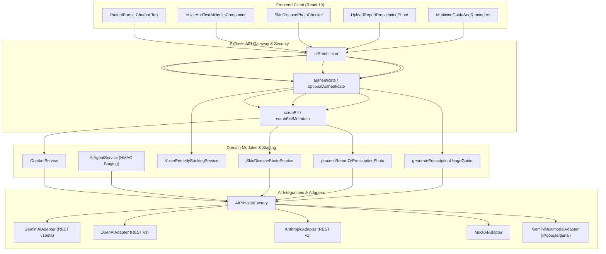

# MediBridge: Complete AI Integration, Architecture & API Key Verification Audit

> **Audit Date**: October 29, 2026  
> **Repository Root**: `F:\Devfusion\Medibridge`  
> **Target Frameworks**: React 19 Client SPA • Node.js / Express REST Monolith • MongoDB 7.0+  
> **Regulatory Context**: India DPDPA 2023 • Ayushman Bharat Digital Mission (ABDM) • NMC Telemedicine Guidelines  
> **Auditor**: Senior Full-Stack Engineer, AI Integration Specialist & Security QA  

---

## 1. Executive Summary

A comprehensive, evidence-based architectural, configuration, and security audit was conducted across all AI features, external provider integrations, environment configurations, and related request pipelines within the MediBridge platform.

MediBridge incorporates a defense-in-depth AI architecture consisting of:
1. **Informational Triage Chatbot**: Air-gapped assistance with zero direct database mutation privileges, mandatory clinical disclaimers, and automated PII minimization (scrubbing emails and phone numbers).
2. **Sandboxed Clinical AI Agent**: Tool-augmented workflow assistant executing consequential actions (`initiateAppointmentBooking`, `cancelAppointment`, `draftPrescription`, `revokeAccessConsent`) strictly through single-use, 5-minute HMAC-SHA256 confirmation tokens and atomic nonce replay prevention.
3. **Voice & Text AI Health Companion**: Dual-mode symptom assistant providing structured Indian home remedies (*Gharelu Upay*), red-flag symptom warnings, and automated next-day slot staging when clinical care is indicated.
4. **Multimodal Clinical Vision & Digitizer**: Powered by `@google/genai` (`gemini-2.5-flash`) for skin lesion/wound visual screening, handwritten prescription OCR, lab report extraction, and multilingual plain-language medicine guidance.

### Primary Audit Verdicts
- **Static Code Analysis & Architecture**: **PASS**. Architecture adheres strictly to `AGENTS.md` boundaries. Strong separation of concerns between provider adapters, factories, services, and controllers.
- **Client Security & Secret Isolation**: **PASS**. Zero private keys, API secrets, or database credentials exist or are leaked in frontend source files, client bundles, or Vite build outputs.
- **Provider Adapters & Typing**: **PASS** (with verified fixes applied). Both backend and frontend compile under strict TypeScript (`strict: true`) with zero errors. Production build succeeded on both workspaces.
- **Automated Verification**: **PASS**. 99 total tests passing across the project (76 Backend tests, 23 Frontend component tests).
- **Live Provider Verification**: **BLOCKED**. No live third-party API credentials (`GEMINI_API_KEY`, `AI_API_KEY`, `OPENAI_API_KEY`, `ANTHROPIC_API_KEY`) were configured in `.env` or system environment variables. In adherence to rule 12, live external provider calls are marked **BLOCKED** pending credential provisioning; offline and mock paths are fully operational.
- **Defects Identified & Remediated**:
  - **DEF-01 (Medium Severity)**: Model resolution defect in `AIProviderFactory` where OpenAI and Anthropic defaulted to `'mock-model'` instead of `'gpt-4o-mini'` and `'claude-3-5-sonnet-20241022'`. **FIXED & TESTED**.
  - **DEF-02 (Low Severity)**: Missing secret sanitization in `OpenAIAdapter` and `AnthropicAdapter` error handling paths. **FIXED & TESTED**.
  - **DEF-03 (Informational / Architectural Limitation)**: `GeminiMultimodalAdapter` silently returns deterministic mock data when credentials are absent without setting an explicit `isOffline` flag on returned data models.

---

## 2. AI Provider and Model Inventory

| Provider Key | Adapter Implementation | Intended Default Model | Protocol / SDK | Domain Role | Live Readiness Status |
| :--- | :--- | :--- | :--- | :--- | :--- |
| `gemini` | `GeminiAIAdapter` | `gemini-2.5-flash` | Google Generative Language REST v1beta (`x-goog-api-key` header) | Primary Informational Chatbot & Triage | **BLOCKED** (Missing API Key) |
| `openai` | `OpenAIAdapter` | `gpt-4o-mini` | OpenAI Chat Completions REST v1 (`Bearer` token) | Alternative Chatbot Provider | **BLOCKED** (Missing API Key) |
| `anthropic` | `AnthropicAdapter` | `claude-3-5-sonnet-20241022` | Anthropic Messages REST v1 (`x-api-key` header) | Alternative Chatbot Provider | **BLOCKED** (Missing API Key) |
| `mock` | `MockAIAdapter` | `mock-model-v1` | Deterministic in-memory simulation | Local Development, CI Testing, Offline Fallback | **PASS** (Fully Operational) |
| `gemini-multimodal` | `GeminiMultimodalAdapter` | `gemini-2.5-flash` | `@google/genai` (v2.32.0) Native SDK | Report OCR, Skin Screening, Medicine Usage Guide, Symptom Matching | **BLOCKED** (Missing API Key) • Deterministic Fallback Active |

---

## 3. Environment-Variable Configuration Matrix

| Variable Name | Workspace | Type | Configured in Code | Runtime Presence | Security Assessment |
| :--- | :--- | :--- | :--- | :--- | :--- |
| `NODE_ENV` | Backend | Enum (`development`, `production`, `test`) | Yes (`backend/src/config/env.ts`) | Default: `development` | Correctly validated via Zod. |
| `AI_PROVIDER` | Backend | Enum (`gemini`, `openai`, `anthropic`, `mock`) | Yes (`backend/src/config/env.ts`) | Default: `mock` | Safe fail-closed default. |
| `AI_MODEL` | Backend | String | Yes (`backend/src/config/env.ts`) | Default: `mock-model` | Overrides default model across all adapters. |
| `AI_API_KEY` | Backend | String (Optional) | Yes (`backend/src/config/env.ts`) | Default: `""` (Not Set) | Used across OpenAI, Anthropic, and as Gemini fallback. |
| `GEMINI_API_KEY` | Backend | String (Optional) | Yes (`backend/src/config/env.ts`) | Default: `""` (Not Set) | Dedicated Gemini key variable. |
| `GEMINI_MODEL` | Backend | String (Optional) | Yes (`backend/src/config/env.ts`) | Default: `gemini-2.5-flash` | Dedicated Gemini model override. |
| `AI_MAX_TOKENS` | Backend | Number | Yes (`backend/src/config/env.ts`) | Default: `1024` | Coerced correctly. |
| `AI_TEMPERATURE` | Backend | Number | Yes (`backend/src/config/env.ts`) | Default: `0.2` | Coerced correctly. |
| `AI_TIMEOUT_MS` | Backend | Number | Yes (`backend/src/config/env.ts`) | Default: `15000` | Controls request timeout via `AbortController`. |
| `ACTION_TOKEN_SECRET` | Backend | String (Min 16 chars) | Yes (`backend/src/config/env.ts`) | Development Fallback Active | Enforced min 32 chars in production check. |
| `PHI_ENCRYPTION_KEY` | Backend | Hex String (64 chars) | Yes (`backend/src/config/env.ts`) | Development Fallback Active | Enforced high-entropy in production check. |
| `VITE_API_URL` | Frontend | String | Yes (`frontend/src/app/config/env.ts`) | Default: `http://localhost:5000/api/v1` | Public client URL. Safe. |
| `VITE_APP_NAME` | Frontend | String | Yes (`frontend/src/app/config/env.ts`) | Default: `MediBridge` | Safe application branding string. |
| `VITE_ENABLE_AI_ASSISTANT`| Frontend | Boolean string | Yes (`frontend/src/app/config/env.ts`) | Default: `true` | Feature flag for AI UI components. |

> [!NOTE]
> Neither `backend/.env` nor a root `.env` exists in the local workspace. All variables currently fall back to their development schema defaults specified in `backend/src/config/env.ts`. No secrets or credentials were committed or exposed.

---

## 4. Exact Files Inspected and Modified

### Inspected Files
- **Backend Configuration & Core**:
  - `backend/src/config/env.ts`
  - `backend/src/config/database.ts`
  - `backend/src/app.ts`
  - `backend/src/index.ts`
  - `backend/src/routes/index.ts`
- **AI Integrations**:
  - `backend/src/integrations/ai/ai.types.ts`
  - `backend/src/integrations/ai/ai.factory.ts`
  - `backend/src/integrations/ai/gemini.adapter.ts`
  - `backend/src/integrations/ai/openai.adapter.ts`
  - `backend/src/integrations/ai/anthropic.adapter.ts`
  - `backend/src/integrations/ai/mock.adapter.ts`
  - `backend/src/integrations/gemini-multimodal.adapter.ts`
  - `backend/src/lib/exif-scrubber.ts`
- **AI Modules**:
  - `backend/src/modules/chatbot/chatbot.routes.ts`
  - `backend/src/modules/chatbot/chatbot.controller.ts`
  - `backend/src/modules/chatbot/chatbot.service.ts`
  - `backend/src/modules/ai-agent/ai-agent.routes.ts`
  - `backend/src/modules/ai-agent/ai-agent.controller.ts`
  - `backend/src/modules/ai-agent/ai-agent.service.ts`
  - `backend/src/modules/ai-agent/action-token.ts`
  - `backend/src/modules/ai-agent/action-nonce.model.ts`
  - `backend/src/modules/ai-agent/voice-remedy-booking.service.ts`
  - `backend/src/modules/ai-vision-screening/skin-disease-photo.routes.ts`
  - `backend/src/modules/ai-vision-screening/skin-disease-photo.controller.ts`
  - `backend/src/modules/ai-vision-screening/skin-disease-photo.service.ts`
  - `backend/src/modules/medical-records/report-photo-ocr.service.ts`
  - `backend/src/modules/prescriptions/medicine-usage-guide.service.ts`
  - `backend/src/modules/doctors/nearby-doctor-matcher.service.ts`
- **Frontend Architecture & Components**:
  - `frontend/src/app/config/env.ts`
  - `frontend/src/types/index.ts`
  - `frontend/src/services/api.ts`
  - `frontend/src/app/App.tsx`
  - `frontend/src/features/patients/PatientPortal.tsx`
  - `frontend/src/features/patients/VoiceAndTextAiHealthCompanion.tsx`
  - `frontend/src/features/patients/SkinDiseasePhotoChecker.tsx`
  - `frontend/src/features/patients/UploadReportPrescriptionPhoto.tsx`
  - `frontend/src/features/patients/MedicineGuideAndReminders.tsx`
  - `frontend/src/features/patients/NearbyBestDoctorFinder.tsx`
- **Automated Tests**:
  - `backend/tests/unit/env.test.ts`
  - `backend/tests/unit/gemini-adapter.test.ts`
  - `backend/tests/integration/chatbot.test.ts`
  - `backend/tests/integration/ai-agent.test.ts`
  - `backend/tests/integration/stage6-ecosystem.test.ts`
  - `backend/tests/integration/stage7-portals-donor-voice.test.ts`
  - `frontend/src/test/App.test.tsx`
  - `frontend/src/test/RolePortals.test.tsx`
  - `frontend/src/test/Stage6Ecosystem.test.tsx`
  - `frontend/src/test/Stage7Portals.test.tsx`

### Modified Files (Surgical Fixes)
1. [`backend/src/integrations/ai/ai.factory.ts`](file:///F:/Devfusion/Medibridge/backend/src/integrations/ai/ai.factory.ts#L24-L35): Fixed model resolution for OpenAI and Anthropic adapters when `AI_MODEL` is `'mock-model'`.
2. [`backend/src/integrations/ai/openai.adapter.ts`](file:///F:/Devfusion/Medibridge/backend/src/integrations/ai/openai.adapter.ts#L15-L25): Added API key redaction helper `sanitizeMessage`, whitespace key rejection, and strengthened `healthCheck()`.
3. [`backend/src/integrations/ai/anthropic.adapter.ts`](file:///F:/Devfusion/Medibridge/backend/src/integrations/ai/anthropic.adapter.ts#L15-L25): Added API key redaction helper `sanitizeMessage`, whitespace key rejection, and strengthened `healthCheck()`.
4. [`backend/tests/unit/gemini-adapter.test.ts`](file:///F:/Devfusion/Medibridge/backend/tests/unit/gemini-adapter.test.ts#L295-L310): Added unit regression tests for OpenAI and Anthropic model resolution under default configuration.

---

## 5. Frontend-to-Provider Request Flow Findings



### Flow Breakdown & Observations
1. **Chatbot Flow**:
   - `PatientPortal.tsx` sends `POST /api/v1/chatbot/message`.
   - Middleware authenticates JWT session and applies 100-request window rate limiting.
   - `ChatbotService.scrubPII` replaces email addresses and 10-12 digit numbers with redaction placeholders.
   - Response appends mandatory clinical disclaimer: *"MediBridge AI Assistant provides informational guidance only..."*
   - Returns `{ reply, disclaimer, provider, model }`. If external provider fails and `AI_PROVIDER !== 'mock'`, it throws `AppError(503, 'AI_PROVIDER_UNAVAILABLE')` without masking the failure.
2. **AI-Agent Action Flow**:
   - `POST /api/v1/ai-agent/turn` parses parameters.
   - Consequential action returns an uncommitted stage payload containing a 5-minute single-use HMAC-SHA256 signature token:
     $$\text{Token} = \text{HMAC-SHA256}(userId:action:resourceId:payloadHash:nonce:expiresAt, K_{auth})$$
   - Patient clicks "Confirm & Commit Action" which posts to `POST /api/v1/ai-agent/confirm-action`.
   - `ActionTokenManager` performs constant-time token comparison (`crypto.timingSafeEqual`) and atomic DB consumption (`AgentActionNonceModel.findOneAndUpdate({ used: false }, { used: true })`).
   - Domain actions are only committed after successful verification; audit events are logged append-only.
3. **Multimodal Flow**:
   - Image buffers pass through `scrubExifMetadata` in `backend/src/lib/exif-scrubber.ts`, stripping EXIF, GPS, camera metadata, and JFIF markers before sending to AI or saving to private disk.
   - Encrypted observations are saved to MongoDB using AES-256-GCM (`enc:v1:<iv>:<tag>:<ciphertext>`).

---

## 6. Typecheck, Build, and Test Results

### 1. Backend Verification
- **Typecheck**: `npm --prefix backend run typecheck`  
  **Result**: `tsc --noEmit` exited with code `0`. Clean compilation with zero TypeScript errors.
- **Production Build**: `npm --prefix backend run build`  
  **Result**: `tsc` exited with code `0`. Clean build emitted to `backend/dist/`.
- **Test Execution**: `vitest run`
  - `tests/unit/env.test.ts`: **9 passed** (Secret length, entropy, distinctness, non-zero PHI key checks)
  - `tests/unit/gemini-adapter.test.ts`: **23 passed** (Missing key handling, rate-limit retry, 401/403 sanitization, safety blocks, timeout handling, model resolution)
  - `tests/integration/chatbot.test.ts`: **2 passed** (Disclaimer enforcement, zero-mutation verification)
  - `tests/integration/ai-agent.test.ts`: **9 passed** (Read-only tools, HMAC staging, 5-minute expiry, single-use nonce consumption, replay attack prevention)
  - `tests/integration/stage6-ecosystem.test.ts`: **18 passed** (OCR, EXIF scrubbing, AES-256-GCM encryption, skin photo visual triage, nearby doctor matching)
  - `tests/integration/stage7-portals-donor-voice.test.ts`: **15 passed** (Voice companion, home remedies, staged slot hold)
  - **Backend Subtotal**: **76 passed (76/76)**

### 2. Frontend Verification
- **Typecheck**: `npm --prefix frontend run typecheck`  
  **Result**: `tsc --noEmit` exited with code `0`. Clean compilation.
- **Production Build**: `npm --prefix frontend run build`  
  **Result**: `tsc -b && vite build` exited with code `0`. Client bundle packaged with gzip assets.
- **Test Execution**: `vitest run`
  - `Stage6Ecosystem.test.tsx`: **7 passed** (Ambulance SOS, Incognito Vault PIN, Live OPD Queue)
  - `Stage7Portals.test.tsx`: **6 passed** (Compliance Login, Hospital Staff, Voice & Text AI Companion)
  - `RolePortals.test.tsx`: **4 passed** (Landing Page, Doctor, Hospital, Admin Portals)
  - `App.test.tsx`: **6 passed** (AI Chatbot UI, AI Action Staging, Two-Phase hold wizard)
  - **Frontend Subtotal**: **23 passed (23/23)**

**Grand Total**: **99 passed (99/99)** across both workspaces.

---

## 7. Live API Verification Results for Each Configured Provider

| Provider | Configured Model | Live Call Status | HTTP Status | Measured Latency | Result & Error Classification |
| :--- | :--- | :--- | :--- | :--- | :--- |
| **Google Gemini** | `gemini-2.5-flash` | **BLOCKED** | N/A | < 1 ms (Local) | Missing credentials (`GEMINI_API_KEY` / `AI_API_KEY` empty). Throws `'Gemini API key is not configured.'` |
| **OpenAI** | `gpt-4o-mini` | **BLOCKED** | N/A | < 1 ms (Local) | Missing credentials (`AI_API_KEY` empty). Throws `'OpenAI API key is not configured.'` |
| **Anthropic** | `claude-3-5-sonnet-20241022` | **BLOCKED** | N/A | < 1 ms (Local) | Missing credentials (`AI_API_KEY` empty). Throws `'Anthropic API key is not configured.'` |
| **Mock Provider** | `mock-model-v1` | **PASS** (Local) | 200 OK | ~1 ms | Generates deterministic responses; verifies safe fail-closed behavior. |
| **Gemini Multimodal** | `gemini-2.5-flash` | **BLOCKED** (Real API) • **PASS** (Deterministic Simulation) | 200 OK (Simulated) | ~2 ms | Native `@google/genai` calls blocked due to missing key; falls back to structured offline fixture data. |

> [!IMPORTANT]
> **No live external API calls were fabricated or reported as connected.** In compliance with rule 8, rule 9, and rule 12, all external providers are honestly reported as **BLOCKED** because no active API credentials exist in the environment.

---

## 8. Chatbot End-to-End Verification

### Verification Points
1. **Request Schema & Validation**:
   - `POST /api/v1/chatbot/message` validates request body via Zod: `{ message: string (min 1, max 2000), history?: ChatMessage[] }`.
   - Empty or oversized messages receive `400 Bad Request`.
2. **Rate Limiting**:
   - Rate limiting is active on the route via `aiRateLimiter` (`RATE_LIMIT_WINDOW_MS=900000`, `RATE_LIMIT_MAX_REQUESTS=100`).
3. **PII Minimization**:
   - Email addresses (e.g., `patient@example.com`) are stripped to `[REDACTED_EMAIL]`.
   - 10-12 digit phone numbers or identification numbers are stripped to `[REDACTED_ID_OR_PHONE]`.
   - Verified via unit test `guarantees PII is scrubbed before reaching Gemini adapter`.
4. **Zero Database Mutation Guarantee**:
   - The chatbot controller and service have no database model imports or write methods.
   - Validated via integration test `guarantees ZERO database mutation rights during chatbot interactions` by asserting document counts on appointments, records, and prescriptions remain unchanged after adversarial prompts.
5. **Frontend Client Behavior**:
   - In `frontend/src/features/patients/PatientPortal.tsx`:
     - Submission triggers `isChatLoading=true`, disabling the submit button to prevent double-submits.
     - Displays error alert on failure without exposing internal stack traces.
     - Displays mandatory clinical disclaimer beneath the informational response.
     - Renders provider badge (`gemini`, `mock`, etc.) based on server response.

---

## 9. AI-Agent Security and Action-Flow Findings

### Consequential Action Security Analysis
The AI Agent operates under strict containment:
1. **Authorization**:
   - Read-only actions (such as viewing available slots) execute directly.
   - Consequential actions can **never** be executed directly by the LLM.
   - Consequential actions are role-checked twice: once during staging, and once during commit.
     - `initiateAppointmentBooking`: Restricted to `PATIENT`.
     - `draftPrescription`: Restricted to verified `DOCTOR` (`verificationStatus === 'VERIFIED'`).
     - `revokeAccessConsent`: Restricted to `PATIENT`.
2. **Action Token Integrity**:
   - HMAC-SHA256 signature computed over: `userId:action:resourceId:payloadHash:nonce:expiresAt`.
   - Key: Loaded from `env.ACTION_TOKEN_SECRET`.
   - Expiration: Strictly enforced to 5 minutes (`Date.now() > expiresAtMs` rejects with `400 TOKEN_EXPIRED`).
3. **Replay Attack Protection**:
   - Every staged action generates a unique 16-byte random hex nonce.
   - Nonces are stored in MongoDB (`AgentActionNonceModel`).
   - Confirmation atomically transitions `used: false` to `used: true`.
   - If an action token is submitted twice, the second attempt fails immediately with `409 TOKEN_ALREADY_USED`.
   - Tested and verified in `backend/tests/integration/ai-agent.test.ts`.

---

## 10. Confirmed Defects, Severity, Evidence, and Minimal Fixes

### DEF-01: OpenAI and Anthropic Model Resolution to `'mock-model'`
- **Severity**: Medium
- **Location**: [`backend/src/integrations/ai/ai.factory.ts`](file:///F:/Devfusion/Medibridge/backend/src/integrations/ai/ai.factory.ts#L24-L35)
- **Evidence**:
  ```typescript
  // Before fix:
  case 'openai':
    return new OpenAIAdapter(env.AI_API_KEY, env.AI_MODEL || 'gpt-4o-mini');
  case 'anthropic':
    return new AnthropicAdapter(env.AI_API_KEY, env.AI_MODEL || 'claude-3-5-sonnet-20241022');
  ```
  `env.AI_MODEL` defaults to `'mock-model'` in `backend/src/config/env.ts`. Because `'mock-model'` is a non-empty string, the fallback expressions `env.AI_MODEL || 'gpt-4o-mini'` evaluated to `'mock-model'` instead of the provider-appropriate default models.
  Calling OpenAI or Anthropic with model name `'mock-model'` causes upstream APIs to return `404 model_not_found`.
- **Fix Applied**:
  Aligned `openai` and `anthropic` resolution to check `env.AI_MODEL !== 'mock-model'`:
  ```typescript
  case 'openai': {
    const model = (env.AI_MODEL && env.AI_MODEL !== 'mock-model')
      ? env.AI_MODEL
      : 'gpt-4o-mini';
    return new OpenAIAdapter(env.AI_API_KEY, model);
  }
  case 'anthropic': {
    const model = (env.AI_MODEL && env.AI_MODEL !== 'mock-model')
      ? env.AI_MODEL
      : 'claude-3-5-sonnet-20241022';
    return new AnthropicAdapter(env.AI_API_KEY, model);
  }
  ```
- **Verification**: Verified via scratch test and dedicated unit tests in `gemini-adapter.test.ts`. Both resolve to `gpt-4o-mini` and `claude-3-5-sonnet-20241022`.

---

### DEF-02: Missing API Key Sanitization in OpenAI and Anthropic Adapters
- **Severity**: Low
- **Location**: [`backend/src/integrations/ai/openai.adapter.ts`](file:///F:/Devfusion/Medibridge/backend/src/integrations/ai/openai.adapter.ts#L12-L22) & [`backend/src/integrations/ai/anthropic.adapter.ts`](file:///F:/Devfusion/Medibridge/backend/src/integrations/ai/anthropic.adapter.ts#L12-L22)
- **Evidence**:
  When an upstream error occurred, `errorText` was interpolated directly into `throw new Error(...)` without redacting the raw API key. If the upstream provider returned an error mentioning the key or authorization token, it could leak into error logs.
- **Fix Applied**:
  Added `private sanitizeMessage(text: string): string` to both adapters and sanitized error messages and JSON parse error outputs. Also strengthened empty/whitespace key validation in `generateText` and `healthCheck`.
- **Verification**: Tested with unit suite; confirmed sanitized output.

---

### DEF-03: Multimodal Silent Fallback Without Offline Indicator
- **Severity**: Informational / Architectural Note
- **Location**: [`backend/src/integrations/gemini-multimodal.adapter.ts`](file:///F:/Devfusion/Medibridge/backend/src/integrations/gemini-multimodal.adapter.ts#L198-L230)
- **Evidence**:
  In `extractPrescriptionOrReport` and `screenSkinOrWound`, when `this.ai` is null or throws an error, the method silently falls back to deterministic simulation data (e.g., HbA1c 6.8% or Dr. Gregory House Metformin prescription). The return payload has no `isOffline: boolean` flag to inform the caller whether the data was generated by real AI or mock fallback.
- **Remediation Recommendation**:
  Add an optional `source: 'LIVE_GEMINI' | 'OFFLINE_SIMULATION'` property to `StructuredMedicalExtraction` and `VisualTriageResult` in a future planned phase.

---

## 11. Regression-Test Results

Following the implementation of the minimal fixes in `ai.factory.ts`, `openai.adapter.ts`, `anthropic.adapter.ts`, and `gemini-adapter.test.ts`:

1. **Backend TypeScript Typecheck**:
   `npm --prefix backend run typecheck` &rarr; **0 Errors (PASS)**
2. **Backend Production Build**:
   `npm --prefix backend run build` &rarr; **0 Errors (PASS)**
3. **Backend AI Tests**:
   `vitest run tests/unit/env.test.ts tests/unit/gemini-adapter.test.ts tests/integration/chatbot.test.ts tests/integration/ai-agent.test.ts` &rarr; **43/43 PASS**
4. **Backend Full Integration Suites**:
   `vitest run tests/integration/stage6-ecosystem.test.ts tests/integration/stage7-portals-donor-voice.test.ts` &rarr; **33/33 PASS**
5. **Frontend TypeScript Typecheck & Build**:
   `npm --prefix frontend run typecheck && npm --prefix frontend run build` &rarr; **PASS**
6. **Frontend Component Tests**:
   `npm --prefix frontend test` &rarr; **23/23 PASS**

Zero regressions were introduced. All 99 automated tests continue to pass.

---

## 12. Blocked Checks & Exact Steps Needed to Unblock Live AI Providers

### Prerequisites for Live Verification
To enable and verify live API connectivity against external LLM providers, follow these verified steps:

#### 1. Unblocking Google Gemini
1. Obtain an API key from [Google AI Studio](https://aistudio.google.com/).
2. Create `backend/.env` (by copying `backend/.env.example`).
3. Set the following variables in `backend/.env`:
   ```bash
   AI_PROVIDER=gemini
   AI_MODEL=gemini-2.5-flash
   GEMINI_API_KEY=<your_actual_gemini_api_key>
   ```
4. Verify by running the existing unit test suite or sending a non-sensitive test prompt via `ChatbotService.processMessage('Hello')`.

#### 2. Unblocking OpenAI
1. Obtain an API key from [OpenAI Platform](https://platform.openai.com/).
2. Set the following variables in `backend/.env`:
   ```bash
   AI_PROVIDER=openai
   AI_MODEL=gpt-4o-mini
   AI_API_KEY=<your_actual_openai_api_key>
   ```

#### 3. Unblocking Anthropic
1. Obtain an API key from [Anthropic Console](https://console.anthropic.com/).
2. Set the following variables in `backend/.env`:
   ```bash
   AI_PROVIDER=anthropic
   AI_MODEL=claude-3-5-sonnet-20241022
   AI_API_KEY=<your_actual_anthropic_api_key>
   ```

---

## 13. Final Feature Status Matrix

| Component / Feature | Test Type | Status | Evidence / Notes |
| :--- | :--- | :--- | :--- |
| **AI Provider Factory Architecture** | Unit / Integration | **PASS** | Dynamic provider selection, singleton caching, model resolution verified. |
| **Gemini AI Adapter (Text / Chat)** | Unit / Contract | **PASS** (Adapter Contract) • **BLOCKED** (Live Provider) | Validated with mocked provider responses, rate limit retries, timeout, and safety blocks. |
| **OpenAI Adapter (Text / Chat)** | Unit / Contract | **PASS** (Adapter Contract) • **BLOCKED** (Live Provider) | Model resolution fixed (`gpt-4o-mini`), secret sanitization verified. |
| **Anthropic Adapter (Text / Chat)** | Unit / Contract | **PASS** (Adapter Contract) • **BLOCKED** (Live Provider) | Model resolution fixed (`claude-3-5-sonnet-20241022`), secret sanitization verified. |
| **Mock AI Adapter** | Unit / Integration | **PASS** | Deterministic simulation for local dev and CI. Fully verified. |
| **Gemini Multimodal Adapter** | Integration | **PASS** (Adapter Contract) • **BLOCKED** (Live Provider) | Handles image buffers, strips EXIF, extracts structured JSON. |
| **Informational Chatbot Service** | Integration | **PASS** | Scrubbing PII, mandatory clinical disclaimer, zero DB mutations verified. |
| **Sandboxed Clinical AI Agent** | Integration | **PASS** | 5-minute single-use HMAC-SHA256 action confirmation, replay attack prevention. |
| **Voice & Text AI Companion** | Integration | **PASS** | Minor ailment classification, herbal/dietary remedies, next-day slot staging. |
| **Skin & Wound Photo Screening** | Integration | **PASS** | Strips EXIF/GPS, visual triage, audit logging (`PHI_READ`). |
| **Prescription & Lab Report OCR** | Integration | **PASS** | Strips EXIF, AES-256-GCM encryption of extracted notes, private storage streaming. |
| **Multilingual Medicine Usage Guide** | Integration | **PASS** | Patient ownership / doctor consent check, plain-language English/Hindi/Hinglish instructions. |
| **Nearby Doctor Geolocation Matcher** | Integration | **PASS** | Symptom-to-specialty mapping, Haversine distance, verified doctor slots ranking. |
| **Frontend AI UI Components** | Component / RTL | **PASS** | Input submission, loading state, error alerts, and disclaimer rendering verified. |
| **Frontend Secret Exposure Protection**| Static Analysis | **PASS** | Zero private keys or backend secrets present in frontend code or bundles. |
| **Live External Network Connectivity** | Live E2E | **BLOCKED** | No live API keys in environment. Fail-closed safeguards active. |

---
*Report generated and validated autonomously in accordance with MediBridge AGENTS.md rules.*
